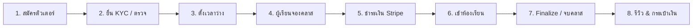

# Runbook — เปิดใช้ระบบตลาดติวเตอร์ (Tutoring Marketplace) บน Production

> เอกสารลำดับขั้นตอนสำหรับเจ้าของระบบและทีม DevOps ในการ apply database migration, ตั้งค่า environment, ตรวจสอบ external services, และเปิดใช้งานโมดูล Tutoring (`Siri.Modules.Tutoring`) บน Production  
> **คำเตือนความปลอดภัย:** ห้าม commit ค่า production secrets (API keys, webhook secrets, encryption keys) ลงใน git เด็ดขาด ทุกค่าจริงต้องใส่ผ่าน environment variables หรือ secret store ของ cluster เท่านั้น

---

## 1. สถานะและสิ่งที่ยังไม่เคยทดสอบกับระบบจริง (Production Reality Check)

ก่อนเริ่มขึ้นระบบจริง ทีมงานต้องเข้าใจข้อเท็จจริงทางเทคนิคดังต่อไปนี้:

| ระบบภายนอก / บริการ | สถานะการทดสอบปัจจุบัน | สิ่งที่ยังไม่เคยทดสอบกับของจริงบน Production |
|---|---|---|
| **Stripe (PromptPay & Cards)** | ผ่าน Unit & Integration Test ด้วย Seam จำลอง (`IStripeClientSeam`), Webhook replay tests | ยังไม่เคยทดสอบจ่ายเงิน PromptPay QR จริงจนจบกระบวนการ, ยังไม่เคยรับ webhook จาก Stripe live cluster จริง (`whsec_...`) |
| **Google Calendar & Meet** | ผ่าน Unit & Integration Test ด้วย Mock provider | ยังไม่เคยเชื่อม OAuth กับบัญชี Google จริงสำหรับห้อง Ad-Hoc Tutoring, ยังไม่เคยสร้าง Google Meet space และส่ง ICS เชิญเข้าปฏิทินจริงของผู้เรียน/ติวเตอร์ |
| **Cloudflare R2 (KYC & Documents)** | ผ่าน Integration Test ด้วย In-memory / MinIO S3 Seam | ยังไม่เคยอัปโหลดและสตรีมไฟล์ KYC ผ่าน R2 bucket จริง, ยังไม่เคยทดสอบการ purge ข้ามวันบน Cloudflare R2 จริง |
| **Email (SMTP)** | ผ่าน Mailpit และ In-memory Outbox | ยังไม่เคยส่งอีเมลยืนยัน/แจ้งเตือนคาบเรียนผ่านเซิร์ฟเวอร์ SMTP จริง |
| **ฐานข้อมูล (PostgreSQL)** | ทดสอบบน **PostgreSQL 18** (Docker dev port 5433) | ฐานข้อมูล Production ปัจจุบันเป็น **PostgreSQL 17** — ความแตกต่างของ minor optimizer และ pg_trgm/btree_gist index plan ต้องสังเกตการณ์ |
| **Redis Cache & Lock** | ทดสอบบน **Garnet 6380** (Redis-compatible) | Production ใช้ **Redis 7+** แท้ — คำสั่ง key pattern, distributed lock, และ cache expiry ต้องสังเกตการณ์ |

> [!IMPORTANT]
> ฟีเจอร์ **Google Drive Recording Auto-Import (P13-16)** ยังคงสถานะ `BLOCK` (รอความชัดเจนเรื่อง Google Workspace Restricted scope และ security assessment) เอกสารฉบับนี้ครอบคลุมเฉพาะ Ad-Hoc Google Meet rooms และ Pasted meeting links เท่านั้น

---

## 2. ลำดับการ Apply Database Migration ของ Tutoring (17 ตัว)

การรัน Migration ต้องรัน **ก่อน** การ Rollout image ใหม่ของ backend เสมอ  
**คำสั่งมาตรฐาน (ผ่าน migration bundle ตาม `database.md`):**
```bash
# รันผ่าน migration bundle (ห้ามเรียก Database.Migrate() ใน Program.cs)
./scripts/migrate-bundle.sh

# หรือใช้ dotnet ef CLI กับ startup project
dotnet ef database update --project src/Siri.Persistence --startup-project src/Siri.Api
```

### 2.1 รายการ Migration เรียงตามลำดับเวลา (Chronological Order)

| # | ชื่อไฟล์ Migration | สรุปสิ่งที่สร้าง / เปลี่ยนแปลง | ข้อควรระวัง / พฤติกรรม Down |
|---|---|---|---|
| 1 | `20261014085920_AddTutoringCore` | สร้าง schema `TUTORING`, ตาราง `TUTORS`, `TUTOR_PROFILES`, `TUTOR_OFFERINGS`, `TUTOR_EDUCATIONS`, `TUTOR_CERTIFICATES`, `TUTORING_SUBJECTS` + seed วิชามาตรฐาน (`TutoringSubjectSeedSql`) | เป็น additive table ล้วน ปลอดภัย |
| 2 | `20261014134023_AddTutorKyc` | ตาราง `KYC_CASES`, `KYC_DOCUMENTS`, `KYC_DOCUMENT_ACCESS_LOGS` | เก็บเอกสารประจำตัวติวเตอร์ (เข้ารหัสที่ระดับแอปพลิเคชัน) |
| 3 | `20261014145610_AddTutorAvailability` | ตาราง `TUTOR_AVAILABILITY_RULES`, `TUTOR_AVAILABILITY_EXCEPTIONS` | กฎเวลาว่างรายสัปดาห์และข้อยกเว้น |
| 4 | `20261014154825_AddTutorSearch` | ตาราง `TUTOR_SEARCH_LOGS`, Gin/Trigram indexes บนชื่อวิชาและหัวข้อติวเตอร์ | ใช้ `pg_trgm` extension ที่มีอยู่แล้ว |
| 5 | `20261014174924_AddTutorBookingCore` | สร้าง `LEARNER_PROFILES`, `TUTOR_SESSIONS`, `TUTOR_BOOKINGS`  <br>• เปิด extension `btree_gist`  <br>• สร้าง exclusion constraint `EX_TUTOR_SESSIONS_NO_OVERLAP` | ⚠️ **ข้อควรระวังพิเศษ:**  <br>1. DB User ที่รัน migration ต้องมีสิทธิ์ `CREATE EXTENSION` (`SUPERUSER` หรือ role owner)  <br>2. Constraint `EX_TUTOR_SESSIONS_NO_OVERLAP` เป็น Raw SQL GiST บน `("TUTOR_ID" WITH =, tstzrange("STARTS_AT_UTC", "BLOCK_ENDS_AT_UTC") WITH &&)` ป้องกันคาบชนกันระดับ hardware/engine |
| 6 | `20261014194910_AddTutoringPayments` | ตาราง `TUTORING_PAYMENTS`, `TUTORING_PAYMENT_ATTEMPTS` | จัดการสถานะการชำระเงินและ payment intents |
| 7 | `20261014222707_AddTutoringEscrowToPayout` | ปรับปรุง schema `PAYOUT`: เพิ่มคอลัมน์ `SOURCE_TYPE`, `ENTRY_KEY`, `ESCROW_STATE` บน `REVENUE_SPLITS` และ `PAYOUT_BATCHES`, ปรับขนาด `PERIOD_KEY` เป็น `varchar(8)` เพื่อรองรับ ISO week (`YYYY-Www`) | 🛑 **Down Guard:** มี PL/pgSQL guard: หากมีแถวที่ `SOURCE_TYPE <> 'Course'` จะโยน `RAISE EXCEPTION 'Cannot roll back AddTutoringEscrowToPayout: tutoring money rows exist'` ป้องกันเงินหาย |
| 8 | `20261014234931_AddTutoringRefundsAndPenalties` | ตาราง `REFUNDS`, `TUTOR_PENALTY_EVENTS` | 🛑 **Down Guard:** โยน `RAISE EXCEPTION 'Cannot roll back AddTutoringRefundsAndPenalties: refund or penalty rows exist'` หากมีข้อมูลการคืนเงินหรือตัดแต้ม |
| 9 | `20261015020536_AddLiveAdhocMeetings` | Schema `LIVE`: ตาราง `ADHOC_MEETINGS`, `ADHOC_MEETING_INVITES` | รองรับห้องเรียนสดแบบ Ad-Hoc 1:1 หรือกลุ่มย่อยของ Tutoring |
| 10 | `20261015030900_AddTutoringSessionAttendance` | คอลัมน์การเข้าเรียน (`TUTOR_JOINED_AT_UTC`, `FINALIZED_AT_UTC`, etc.) และตาราง `SESSION_JOIN_LOGS` | บันทึกหลักฐาน Audit การเข้าร่วมคลาส |
| 11 | `20261015031042_AddTutoringSessionContent` | ตาราง `SESSION_SUMMARIES`, `SESSION_MATERIALS` | เอกสารประกอบการสอน สรุปบทเรียน และการบ้าน |
| 12 | `20261015052911_AddTutoringReminderColumns` | คอลัมน์สถานะและเวลาส่งแจ้งเตือน (`REMINDER_LONG_SENT_AT_UTC`, etc.) บน `TUTOR_BOOKINGS` และ `TUTOR_SESSIONS` | สนับสนุน Recurring Job ส่งเตือน |
| 13 | `20261015080455_AddTutoringDisputes` | ตาราง `DISPUTES`, `DISPUTE_MESSAGES`, `DISPUTE_EVIDENCE_LINKS` | 🛑 **Down Guard:** โยน `RAISE EXCEPTION 'Cannot roll back AddTutoringDisputes: dispute rows exist'` |
| 14 | `20261015095334_AddTutorPackages` | ตาราง `TUTOR_PACKAGES`, `PACKAGE_PURCHASES`, `PACKAGE_CREDITS` | 🛑 **Down Guard:** โยน `RAISE EXCEPTION 'Cannot roll back AddTutorPackages: package purchase rows exist'` |
| 15 | `20261019135551_AddTutoringPdpa` | เพิ่มคอลัมน์ PDPA และ Data Retention บน `LEARNER_PROFILES` (`ANONYMISED_AT_UTC`, `ANONYMISED_REASON`) | 🛑 **Down Guard:** โยน `RAISE EXCEPTION 'Cannot roll back AddTutoringPdpa: anonymised profiles exist'` |
| 16 | `20261019152402_AddTutoringAnalyticsIndexes` | Covering indexes สำหรับคิวรีสถิติ Admin Analytics (รายได้, การค้นหา, อัตราคงอยู่) | เพิ่มความเร็วคิวรีสรุปผล ไม่บล็อกตาราง |
| 17 | `20261019174406_AddTutorReviews` | ตาราง `TUTOR_REVIEWS` และดัชนีคะแนนรีวิว | 🛑 **Down Guard:** โยน `RAISE EXCEPTION 'Cannot roll back AddTutorReviews: review rows exist'` |

### 2.2 คำสั่ง SQL ตรวจสอบความถูกต้องหลัง Apply Migration

```sql
-- 1. ตรวจสอบ Extension btree_gist และ pg_trgm
SELECT extname, extversion FROM pg_extension WHERE extname IN ('btree_gist', 'pg_trgm');

-- 2. ตรวจสอบ Exclusion Constraint บน TUTOR_SESSIONS
SELECT conname, contype, conrelid::regclass 
FROM pg_constraint 
WHERE conname = 'EX_TUTOR_SESSIONS_NO_OVERLAP';

-- 3. ตรวจสอบว่าตารางหลักของ TUTORING ครบถ้วน
SELECT table_schema, count(*) 
FROM information_schema.tables 
WHERE table_schema = 'TUTORING' 
GROUP BY table_schema;
-- ต้องได้ >= 16 ตาราง

-- 4. ตรวจสอบวิชาเริ่มต้นที่ถูก Seed
SELECT count(*) FROM "TUTORING"."TUTORING_SUBJECTS";
-- ต้องได้ >= 24 รายการวิชา
```

---

## 3. Environment Variables และ Configuration (`Tutoring:*`)

การตั้งค่าระบบ Tutoring ถูกตรวจสอบอย่างเข้มงวดโดย `ProductionConfigurationGuard.cs`, `TutoringProductionRequirements.cs`, `TutoringKycProductionRequirements.cs`, และ `TutoringPaymentProductionRequirements.cs`  
หากค่าใดไม่ผ่านเกณฑ์ **API Process และ Workers Process จะปฏิเสธการบูตทันที (Fail-Fast)**

### 3.1 ตาราง Environment Variables ทั้งหมดของ Tutoring

| Environment Variable (Key ใน JSON) | ค่า Default ใน Code | ต้องตั้งบน Production ไหม | ผลลัพธ์หากตั้งค่าผิด / ไม่ตั้ง |
|---|---|---|---|
| `Tutoring__PublicBaseUrl` | ว่าง (Fallback ไปที่ `Seo:PublicBaseUrl`) | **แนะนำให้ตั้ง** (ต้องขึ้นต้นด้วย `https://`) | Guard ตรวจ: หากไม่มีค่า `https://` ทั้งสองที่ ระบบจะไม่ยอมบูต |
| `Tutoring__DefaultCommissionPercent` | `20` | ค่าเริ่มต้น 20% (ปรับได้ระหว่าง 0.01 ถึง 50) | Guard ตรวจ: ใน Production **ห้ามเป็น 0** (0 จะทำให้แพลตฟอร์มไม่ได้ส่วนแบ่งเลย) และต้องไม่เกิน 50 |
| `Tutoring__Kyc__Enabled` | `false` | **เริ่มต้นตั้ง `false`** จนกว่าจะตั้ง R2 Bucket และ 2FA เสร็จ | หากตั้ง `true` โดยไม่มี R2 KYC หรือขาด 2FA ระบบจะไม่ยอมบูต |
| `Tutoring__Kyc__AdminTwoFactorEnforced` | `false` | ตั้ง `true` เมื่อยืนยันว่า Admin ทุกคนเปิด 2FA แล้ว (X-39) | หาก `Kyc__Enabled=true` ค่านี้ต้องเป็น `true` เท่านั้น |
| `Tutoring__Kyc__ConsentVersion` | `2026-10-v1` | ใช้ตามเวอร์ชันข้อตกลง PDPA | ห้ามเป็นค่าว่าง |
| `Tutoring__JoinWindowMinutes` | `15` | ปกติไม่ต้องแก้ (15 นาที) | กำหนดเวลาก่อนคลาสเริ่มที่ผู้เรียนกดรับลิงก์ห้องได้ |
| `Tutoring__TutorJoinWindowMinutes` | `60` | ปกติไม่ต้องแก้ (60 นาที) | ติวเตอร์เข้าเตรียมห้องได้ล่วงหน้า 1 ชั่วโมง |
| `Tutoring__DisputeWindowHours` | `24` | 24 ชั่วโมงหลังจบคาบ | กรอบเวลาที่ผู้เรียน/ติวเตอร์เปิดข้อพิพาทเพื่อระงับ Escrow |
| `Tutoring__Cancellation__FullRefundHours` | `24` | 24 ชั่วโมง | ยกเลิกก่อนเวลานี้ได้เงินคืนเต็มจำนวน |
| `Tutoring__Cancellation__LateRefundPercent` | `50` | 50% | สัดส่วนเงินคืนกรณีผู้เรียนยกเลิกกระชั้นชิด (ส่วนที่เหลือเป็นค่าเสียเวลาติวเตอร์) |
| `Tutoring__Cancellation__BlockCancelAfterJoin`| `true` | ต้องเป็น `true` | หากกดเข้าห้องเรียนแล้ว ห้ามกดยกเลิกขอเงินคืน |
| `Payout__EstimatedPaymentFeePercent` | (ดู Payout section) | **ต้อง > 0 ใน Production** (เช่น `3.65`) | Guard ตรวจ: ใช้คำนวณ fee estimate พักเงินใน ledger ก่อน reconcile จริง |
| `Live__AdHoc__AllowedJoinUrlOrigins__0` | ว่าง | **ต้องมี origin ตรงกับ `Tutoring__PublicBaseUrl`** | Guard ตรวจ: หาก origin ของลิงก์ Tutoring ไม่อยู่ใน allowlist ห้องเรียน Ad-Hoc จะถูกปฏิเสธ |
| `Storage__R2Kyc__BucketName` | ว่าง | ต้องตั้งเมื่อเปิด KYC (`Kyc__Enabled=true`) | Guard ตรวจ: **ต้องเป็น Bucket แยกจาก `Storage:R2:BucketName`** |
| `Storage__R2Kyc__AccessKeyId` | ว่าง | ต้องตั้งเมื่อเปิด KYC | Guard ตรวจ: **ต้องใช้ Key คนละชุดกับ Storage ปกติ** |
| `Storage__R2Kyc__SecretAccessKey` | ว่าง | ต้องตั้งเมื่อเปิด KYC | Guard ตรวจ: **ต้องใช้ Secret คนละชุดกับ Storage ปกติ** |
| `DataProtection__EncryptionKeyBase64` | Placeholder ใน dev | **ต้องเป็น 32-byte Base64 แท้** (`openssl rand -base64 32`) | ใช้เป็น Master Key ในการเข้ารหัสไฟล์ KYC (AES-256-GCM) และบัญชีธนาคาร |

---

## 4. การตั้งค่าบริการภายนอก (External Services Setup)

### 4.1 Stripe Webhooks และ Payment Intents
1. ใน **Stripe Dashboard** (โหมด Live หรือ Test):
   - สร้าง Webhook Endpoint ไปที่: `POST https://<api-domain>/api/commerce/webhooks/stripe`
   - Events ที่ต้องเปิดรับสำหรับระบบคอร์สและติวเตอร์:
     - `payment_intent.succeeded`
     - `payment_intent.payment_failed`
     - `payment_intent.canceled`
     - `charge.refunded`
     - `charge.refund.updated`
   - คัดลอก Signing Secret (`whsec_...`) มาใส่ใน `Payment__Stripe__WebhookSecret`
2. **วิธีการทดสอบ Webhook:**
   - ใช้ Stripe CLI: `stripe trigger payment_intent.succeeded` ส่งเข้า endpoint เพื่อยืนยันว่า log ขึ้นสถานะ 200 OK และไม่ติด limiter

### 4.2 Google Cloud Console (OAuth & Meet)
1. **Google Cloud Project** เดียวกับระบบ Live Courses เดิม:
   - ตรวจสอบว่าเปิดใช้งาน **Google Calendar API** และ **Google Meet REST API** แล้ว
   - OAuth Consent Screen: ต้องระบุ Scope:
     - `openid`
     - `email`
     - `https://www.googleapis.com/auth/calendar.events.owned`
     - `https://www.googleapis.com/auth/meetings.space.readonly`
2. **OAuth 2.0 Client IDs**:
   - Authorized Redirect URIs ต้องมี callback endpoint:  
     `https://<api-domain>/api/live/instructor/google/callback`
   - ใส่ `Integrations__Google__ClientId` และ `Integrations__Google__ClientSecret` ให้ทั้ง API และ Workers pod

### 4.3 Cloudflare R2 สำหรับ KYC Bucket
1. สร้าง R2 Bucket ใหม่โดยเฉพาะ เช่น `siriupskill-kyc-prod` (ห้ามใช้ bucket เดียวกับคลังสื่อการสอนหรือรูปโปรไฟล์เด็ดขาด)
2. ปิด Public Access ทั้งหมด (Private Bucket 100%)
3. สร้าง R2 API Token ชนิด **Object Read & Write** เจาะจงเฉพาะ bucket `siriupskill-kyc-prod` เท่านั้น
4. นำ Credentials มาใส่ใน `Storage__R2Kyc__*`

### 4.4 SMTP Email Gateway
1. กำหนด `Email__Provider=Smtp`
2. ใส่ `Email__Smtp__Host`, `Port`, `Username`, `Password`, `UseStartTls=true`
3. ตั้ง `Email__Smtp__FromAddress` เป็นโดเมนที่ผ่านการตั้งค่า SPF/DKIM/DMARC เรียบร้อย

---

## 5. ตารางงานเบื้องหลัง Hangfire (17 Recurring Jobs)

โมดูล Tutoring มีงานประจำทั้งหมด 17 ตัว (อยู่ใน `Siri.Workers/RecurringJobIds.cs` และ `RecurringJobsRegistration.cs`)  
เมื่อรันโหมด `Hangfire__ServerInApi=true` API Process จะเป็นผู้รันงานเหล่านี้ แต่หากมี Workers Process แยก งานจะถูกกระจายและแย่งล็อกผ่าน Distributed Lock อย่างปลอดภัย

| # | Job ID (`RecurringJobIds`) | กำหนดเวลา (Cron) | หน้าที่และความรับผิดชอบ | รันที่ไหน | อาการเมื่อพัง / ผลกระทบ | วิธีตรวจสอบ / แก้ปัญหา |
|---|---|---|---|---|---|---|
| 1 | `tutoring-hold-expiry` | ทุก 1 นาที (`* * * * *`) | ปิด Hold การจองที่หมดเวลาชำระเงิน (15 นาที) คืน slot เวลาให้คนอื่น | Api / Workers | Slot เวลาถูกกั๊ก ผู้เรียนคนอื่นจองไม่ได้ | ดู log `Tutoring hold expiry`, ดูคิวใน `/hangfire` |
| 2 | `tutoring-session-finalize` | ทุก 1 นาที (`* * * * *`) | ตรวจสอบการเข้าเรียน (No-Show, Complete), ปล่อยเงิน Escrow หรือคืนเงิน, Nudge ติวเตอร์ | Api / Workers | คลาสที่จบแล้วเงินค้าง ไม่ตัดสถานะ Completed | ดู metric `tutoring.finalize.decisions` |
| 3 | `tutoring-reminders` | ทุก 1 นาที (`* * * * *`) | ส่ง Notification & Email เตือนคลาสเรียนล่วงหน้า 24 ชม. และ 15 นาที | Api / Workers | ผู้เรียน/ติวเตอร์ลืมเข้าเรียน, ขาดการแจ้งเตือน | ดู metric `tutoring.reminders.sent` |
| 4 | `live-adhoc-sync` | ทุก 1 นาที (`* * * * *`) | สร้าง/ซิงค์ Google Calendar & Meet สำหรับห้องเรียน Ad-Hoc Tutoring | Api / Workers | ห้อง Meet ไม่ถูกสร้าง คาบค้างสถานะรอห้อง | ตรวจ token Google ของติวเตอร์ |
| 5 | `tutoring-refund-process` | ทุก 1 นาที (`* * * * *`) | ยิงคำสั่ง Refund ไปยัง Stripe ตามคิวที่อนุมัติแล้ว | Api / Workers | คำขอคืนเงินค้างสถานะ Requested ผู้เรียนไม่ได้เงินคืน | ตรวจสอบ Stripe balance / API keys |
| 6 | `tutoring-payment-reconcile` | ทุก 5 นาที (`*/5 * * * *`) | ตรวจสอบสถานะ Payment Intent ที่ค้าง และอัปเดตค่าธรรมเนียมจริงจาก Stripe | Api / Workers | ยอดโอนอาจมีความคลาดเคลื่อนของค่าธรรมเนียม | ดู log `tutoring payment reconcile` |
| 7 | `tutoring-suspended-sweep` | ทุก 5 นาที (`*/5 * * * *`) | ยกเลิกและคืนเงินคลาสในอนาคตของติวเตอร์ที่ถูกระงับสิทธิ์ | Api / Workers | ติวเตอร์ถูกแบนแต่ผู้เรียนยังเข้าคลาสได้ | ดู log `tutoring suspended sweep` |
| 8 | `tutoring-next-available` | ทุก 10 นาที (`*/10 * * * *`) | คำนวณวันว่างถัดไป (`NEXT_AVAILABLE_AT_UTC`) บนโปรไฟล์เพื่อใช้จัดเรียงใน Search | Api / Workers | ลำดับการค้นหาหน้าแรกไม่อัปเดต | ดู log `next available recompute` |
| 9 | `tutoring-refund-reconcile` | ทุก 15 นาที (`*/15 * * * *`) | ตรวจสอบ Refund ที่รอดำเนินการนาน และปล่อยเงินติวเตอร์เมื่อพ้นระยะเวลา | Api / Workers | เงินติวเตอร์ปลดล็อกช้ากว่ากำหนด | ตรวจสอบสถานะตาราง `REFUNDS` |
| 10 | `tutoring-dispute-aging` | ทุก 30 นาที (`*/30 * * * *`) | เตือน Admin เมื่อข้อพิพาทค้างเกิน SLA (24, 48, 72, 168 ชม.) | Api / Workers | ข้อพิพาทค้างนานโดยไม่มีใครดูแล | ดู metric `tutoring.disputes.aging_alerts` |
| 11 | `tutoring-kyc-purge` | ทุกชั่วโมง นาทีที่ 10 (`10 * * * *`) | ลบไฟล์เอกสาร KYC ออกจาก R2 เมื่อพ้นกำหนด Retention | Api / Workers | เอกสารบัตรประชาชนค้างใน Bucket ผิดนโยบาย PDPA | ตรวจสอบ R2 bucket permissions |
| 12 | `tutoring-package-expiry` | ทุกชั่วโมง นาทีที่ 10 (`10 * * * *`) | ยกเลิกแพ็กเกจที่หมดอายุ และตัดจ่ายเครดิตคงค้างให้ติวเตอร์ | Api / Workers | เครดิตที่หมดอายุไม่ถูกเคลียร์เป็นรายได้ติวเตอร์ | ดู log `package expiry` |
| 13 | `tutoring-kyc-expiry` | ทุกวัน 02:30 UTC | ส่งอีเมลเตือนติวเตอร์ที่เอกสาร KYC ใกล้หมดอายุ | Api / Workers | ติวเตอร์ไม่ทราบว่าเอกสารหมดอายุ | ดูตาราง `KYC_DOCUMENTS` |
| 14 | `tutoring-search-log-purge`| ทุกวัน 03:30 UTC | ล้างประวัติคำค้นหาใน `TUTOR_SEARCH_LOGS` ที่เก่าเกิน 90 วัน | Api / Workers | ตารางคำค้นหาบวมโต | ตรวจสอบขนาดตารางใน DB |
| 15 | `tutoring-reliability-recompute` | ทุกวัน 03:30 UTC | คำนวณ Reliability Score ของติวเตอร์ใหม่เมื่อแต้มลบพ้นกำหนด 90 วัน | Api / Workers | แต้มติวเตอร์ไม่ฟื้นฟูตามเวลา | ดูตาราง `TUTORS.RELIABILITY_SCORE` |
| 16 | `tutoring-review-reconcile`| ทุกวัน 04:30 UTC | ตรวจสอบและซ่อมแซมคะแนนรีวิวเฉลี่ยบนโปรไฟล์ติวเตอร์ให้ตรงกับรีวิวจริง | Api / Workers | ดาวเฉลี่ยบนหน้าการ์ดไม่ตรงกับรีวิว | ดู metric `tutoring.reviews.reconcile` |
| 17 | `tutoring-retention` | ทุกวัน 05:00 UTC | ขัดล้างข้อมูล PII (IP เข้าห้อง, IP ตรวจ KYC, ข้อความ dispute เก่า) | Api / Workers | เก็บ IP และข้อความเก่าเกินความจำเป็นตามกฎหมาย | ดู metric `tutoring.retention.rows` |

---

## 6. Metrics และ Alerting Rules (เชื่อมต่อกับ `alerting-rules.md`)

โมดูล Tutoring ปล่อย Metrics ภายใต้ OpenTelemetry Meter: **`Siri.Tutoring`**  
เกณฑ์การตั้งแจ้งเตือนที่แนะนำใน Prometheus / Alertmanager:

| Alert Name | Metric / PromQL Expression | ช่วงเวลาตรวจ | ความรุนแรง (Severity) | คำอธิบายและการรับมือ |
|---|---|---|---|---|
| **TutoringRoomSyncFailures** | `increase(tutoring_room_sync_failures_total[10m]) > 3` | 5 นาที | **High (Sev 2)** | ซิงค์ห้อง Meet สำหรับติวเตอร์ไม่สำเร็จ ตรวจสอบ OAuth token หรือโควตา Google API |
| **TutoringRefundStuck** | `increase(tutoring_refund_process_failures_total[15m]) > 0` | 10 นาที | **High (Sev 2)** | ยิง Refund ไป Stripe ไม่สำเร็จ ตรวจสอบ Stripe API key หรือยอดคงเหลือใน Stripe Balance |
| **TutoringDisputeAgingBreached** | `increase(tutoring_disputes_aging_alerts_total{level="4"}[1h]) > 0` | 15 นาที | **Warning (Sev 3)** | มีข้อพิพาทค้างเกิน 168 ชม. (7 วัน) แจ้งเตือนทีม Customer Support เข้ารับเรื่องด่วน |
| **TutoringJoinDeniedHigh** | `sum(rate(tutoring_join_denied_total[5m])) > 5` | 5 นาที | **Warning (Sev 3)** | มีการปฏิเสธการเข้าห้องเรียนสูงผิดปกติ ตรวจสอบเวลาเครื่องเซิร์ฟเวอร์หรือ join window config |
| **TutoringKycPhotoDeleteFailed** | `increase(tutoring_pdpa_photo_delete_failed_total[1h]) > 0` | 30 นาที | **Warning (Sev 3)** | ลบรูปโปรไฟล์ติวเตอร์ที่ถูกลบบัญชีออกจาก Bucket ไม่สำเร็จ ต้องเข้าไปลบด้วยมือใน R2 |
| **TutoringAnalyticsBusyRate** | `sum(rate(tutoring_analytics_rejected_total{reason="busy"}[5m])) > 0.5` | 5 นาที | **Warning (Sev 3)** | คิวรี Admin Analytics ถูกปฏิเสธเนื่องจากคิวเต็ม พิจารณาขยาย Cache หรือจังหวะเรียก |

---

## 7. เช็คลิสต์ทดสอบเดินระบบด้วยมือหลัง Deploy (Manual Smoke Test)

ลำดับขั้นตอนการทดสอบฟังก์ชันหลักจากหน้าเว็บจริง (ใช้เวลาประมาณ 15-20 นาที):



1. **สมัครโปรไฟล์ติวเตอร์:**
   - เข้า `/become-tutor` หรือ `/instructor/tutoring/onboarding`
   - กรอกประวัติ แนะนำตัวสั้น ๆ เลือกวิชาที่สอน และตั้งราคาต่อชั่วโมง
2. **ยื่นเอกสาร KYC (หากเปิด `Tutoring:Kyc:Enabled`):**
   - ที่หน้า `/instructor/tutoring/kyc` อัปโหลดบัตรประชาชน และวุฒิการศึกษา
   - เข้าบัญชี Admin ที่ `/admin/tutoring/kyc` ตรวจสอบและกดอนุมัติ (Approved)
3. **กำหนดเวลาว่าง (Availability):**
   - ติวเตอร์เข้า `/instructor/tutoring/availability`
   - ตั้งเวลาว่างประจำสัปดาห์ (Weekly Rules) เช่น วันนี้ในอีก 30 นาทีข้างหน้า
4. **ค้นหาและจองคลาส (ฝั่งผู้เรียน):**
   - ผู้เรียนเข้า `/tutors` ค้นหาติวเตอร์ตามวิชา เลือกดูโปรไฟล์ `/tutors/<slug>`
   - เลือกวิชาและเวลา กดจองคลาสทดลองเรียน (Trial) หรือคลาสเดี่ยวปกติ
5. **ชำระเงิน (Checkout):**
   - ที่หน้า `/tutoring/checkout/<booking-id>`
   - ชำระเงินผ่าน PromptPay QR หรือบัตรทดสอบ Stripe
   - ยืนยันว่าหน้าจอเปลี่ยนเป็น "จองสำเร็จ" และมีรายการใน `/my-tutoring`
6. **เข้าห้องเรียนและการแจ้งเตือน (Join Gate):**
   - ตรวจสอบว่าได้รับอีเมลยืนยันการจองพร้อมไฟล์นัดหมาย `.ics`
   - เมื่อถึงก่อนเวลา 15 นาที ปุ่ม "เข้าห้องเรียน" ที่ `/my-tutoring` ต้องเปิดให้กด
   - ติวเตอร์และผู้เรียนกดเข้าห้อง ลิงก์ต้องพาไปยังห้อง Google Meet ที่ถูกต้อง
7. **จบคาบเรียนและการตัดสินผล (Finalize):**
   - ติวเตอร์กดปุ่ม "สอนเสร็จสิ้น" ที่ `/instructor/tutoring/classes/<id>` หรือรอ job `tutoring-session-finalize` รันเมื่อหมดเวลา
   - สถานะของ Booking เปลี่ยนเป็น `Completed`
8. **รีวิวและตรวจสอบเงินในกระเป๋า (Wallet):**
   - ผู้เรียนเข้า `/my-tutoring` กดเขียนรีวิวและให้คะแนน 5 ดาว
   - ตรวจสอบว่ารีวิวไปแสดงบนหน้าโปรไฟล์สาธารณะของติวเตอร์
   - ติวเตอร์เข้า `/instructor/tutoring/wallet` ตรวจสอบยอดเงินส่วนแบ่งในสถานะ `Held` (รอ 24 ชม. พ้น dispute window จึงจะเข้า `Releasable`)

---

## 8. แผนการ Rollback และข้อจำกัดความปลอดภัย

> [!CAUTION]
> หากระบบขึ้นสู่ Production และเริ่มมีการทำธุรกรรมทางการเงินแล้ว **ห้ามสั่ง Rollback Database Migration เด็ดขาด** เพราะ Migration ของระบบเงินมี Guard ขัดขวาง และจะเกิดความเสียหายต่อสมุดบัญชีเงินฝาก Escrow

### 8.1 การประเมินความสามารถในการ Rollback ของ Migration

- **Migration ที่ย้อนกลับได้ (เมื่อยังไม่มีข้อมูลในตาราง):**  
  `AddTutoringCore`, `AddTutorKyc`, `AddTutorAvailability`, `AddTutorSearch`, `AddTutorBookingCore`, `AddTutoringPayments`, `AddLiveAdhocMeetings`, `AddTutoringSessionAttendance`, `AddTutoringSessionContent`, `AddTutoringReminderColumns`, `AddTutoringAnalyticsIndexes`.
- **Migration ที่มี Guard ปฏิเสธการย้อนกลับทันทีที่มีข้อมูล (Non-Reversible once populated):**  
  - `AddTutoringEscrowToPayout`: ห้ามย้อนหากมีข้อมูลใน `PAYOUT.REVENUE_SPLITS` หรือ `PAYOUT.PAYOUT_BATCHES` ที่เป็นของ Tutoring
  - `AddTutoringRefundsAndPenalties`: ห้ามย้อนหากมีข้อมูลใน `TUTORING.REFUNDS` หรือ `TUTOR_PENALTY_EVENTS`
  - `AddTutoringDisputes`: ห้ามย้อนหากมีข้อมูลใน `TUTORING.DISPUTES`
  - `AddTutorPackages`: ห้ามย้อนหากมีข้อมูลใน `TUTORING.PACKAGE_PURCHASES`
  - `AddTutoringPdpa`: ห้ามย้อนหากมีโปรไฟล์ที่ผ่านการ Anonymize ใน `TUTORING.LEARNER_PROFILES`
  - `AddTutorReviews`: ห้ามย้อนหากมีข้อมูลใน `TUTORING.TUTOR_REVIEWS`

### 8.2 การปิดฟังก์ชันการทำงานอย่างปลอดภัยด้วย Feature Flags (Safe Rollback)

หากพบปัญหาทางเทคนิคในระบบ Production ให้ใช้วิธี **ปิด Feature Flag** ผ่าน Environment Variables โดยไม่ต้องถอย Database Migration:

| ปัญหาที่พบ | ให้ตั้งค่า Environment Variable | ผลกระทบของระบบ |
|---|---|---|
| **พบปัญหาความปลอดภัยในเอกสาร KYC** | `Tutoring__Kyc__Enabled=false` | ทุก Endpoint ของ KYC ตอบ 503 ทันที, ไม่มีการรับไฟล์ใหม่ ติวเตอร์ยังสอนได้ปกติ |
| **พบปัญหากระแสรีวิวป่วน / รีวิวค้าง** | `Tutoring__Reviews__Enabled=false` | ซ่อนรีวิวสาธารณะทั้งหมด Endpoint รีวิวตอบ 404 โดยคะแนนเดิมใน DB ไม่เสียหาย |
| **พบปัญหาในระบบข้อพิพาท** | `Tutoring__Disputes__Enabled=false` | ผู้เรียนเปิดข้อพิพาทใหม่ไม่ได้ (ตอบ 404) แต่เคสเดิม Admin ยังจัดการได้ |
| **ภาระโหลดหนักจากหน้า Admin Analytics**| `Tutoring__Analytics__Enabled=false` | ปิดหน้าจอ Analytics ทุก endpoint ตอบ 404 ลดภาระฐานข้อมูลทันที |
| **พบช่องโหว่ในการอัปโหลดไฟล์สื่อการสอน** | `Tutoring__Materials__FilesEnabled=false` | ปิดการอัปโหลดไฟล์แนบ อนุญาตเฉพาะการแปะลิงก์และการบ้านข้อความ |

---

## 9. งานที่ต้องให้เจ้าของระบบตัดสินใจและดำเนินการต่อ (Outstanding Owner Tasks)

ก่อนเปิดรับผู้ใช้งานทั่วไปอย่างเป็นทางการ เจ้าของโปรเจ็คต้องดำเนินการในประเด็นกฎหมายและความปลอดภัยต่อไปนี้:

1. **การบังคับใช้ 2FA สำหรับบัญชีผู้ดูแลระบบ (X-39):**
   - ข้อกำหนดใน `DECISIONS.md` ระบุชัดเจนว่า การเปิดรับเอกสาร KYC (บัตรประชาชน/ทะเบียนบ้าน) ต้องกระทำหลังจาก Admin ทุกคนเปิดใช้ Two-Factor Authentication แล้วเท่านั้น
2. **ข้อตกลงทางกฎหมาย ภาษี และ PDPA (Q14):**
   - ยืนยันข้อความยินยอมของผู้ปกครองสำหรับผู้เรียนที่เป็นผู้เยาว์ (`GuardianConsentVersion = "2026-10-v1"`) ร่วมกับที่ปรึกษากฎหมาย
   - ยืนยันแนวทางการออกใบเสร็จรับเงินและการหักภาษี ณ ที่จ่ายสำหรับค่าสอนของติวเตอร์
   - กำหนดนโยบายภาษีและบัญชีสำหรับกรณี "เครดิตแพ็กเกจหมดอายุ" (`Tutoring:Packages:ExpiredCreditSettlement`) ว่าจะปล่อยเป็นรายได้ติวเตอร์ (`ReleaseToTutor`) หรือคืนเงินผู้เรียน (`RefundLearner`)
3. **การตรวจสอบช่องโหว่ NuGet Dependencies (X-42):**
   - ตรวจสอบ `dotnet list package --vulnerable` ก่อนขึ้น Production Build
4. **การตั้งค่า Forwarded Headers และ Rate Limiting (X-44, X-45):**
   - ตรวจสอบการส่ง `X-Forwarded-For` และ `X-Forwarded-Proto` จาก Reverse Proxy (Caddy / Nginx) ให้เข้าสู่ API เพื่อให้ Rate Limiter แยกตาม IP จริงของผู้ใช้งานได้อย่างถูกต้อง

---

## 10. รายการสิ่งที่ผู้เขียนยังตรวจไม่ได้ (Pending Verification Checklist)

หัวข้อต่อไปนี้เป็นการสังเกตเชิงสถาปัตยกรรมที่ผู้เขียนรวบรวมไว้เพื่อให้ Integrator (Claude Code) และเจ้าของระบบร่วมตรวจสอบขั้นสุดท้าย:

1. [ ] **ความสอดคล้องของ timezone ใน Exclusion Constraint:** Constraint `EX_TUTOR_SESSIONS_NO_OVERLAP` ทำงานบน `timestamptz` (UTC) ควรทดสอบด้วย session ที่สร้างข้ามช่วง daylight saving หรือรอยต่อเที่ยงคืน Asia/Bangkok
2. [ ] **พฤติกรรมของ Stripe Webhook Signature ภายใต้ Load สูง:** ตามข้อสังเกตความปลอดภัย B-3 (P13-32) Rate Limiter ของ Webhook ควรได้รับการตรวจสอบว่าไม่มีขยะจากภายนอกมาตัดโควตาของ Stripe Event จริง
3. [ ] **Storage Quota & Lifecycle Rules บน Cloudflare R2:** ยืนยันว่า Bucket ของ KYC มีการตั้งค่า Lifecycle Rules สอดคล้องกับ Retention Period ในแอปพลิเคชันหรือไม่ เพื่อความปลอดภัยสองชั้น
