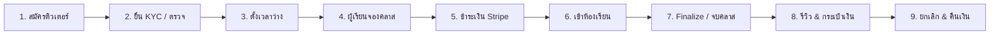

# Runbook — เปิดใช้ระบบตลาดติวเตอร์ (Tutoring Marketplace) บน Production

> เอกสารลำดับขั้นตอนสำหรับเจ้าของระบบและทีม DevOps ในการ apply database migration, ตั้งค่า environment, ตรวจสอบ external services, และเปิดใช้งานโมดูล Tutoring (`Siri.Modules.Tutoring`) บน Production  
> **คำเตือนความปลอดภัย:** ห้าม commit ค่า production secrets (API keys, webhook secrets, encryption keys) ลงใน git เด็ดขาด ทุกค่าจริงต้องใส่ผ่าน environment variables หรือ secret store ของ cluster เท่านั้น
>
> **สถานะ ณ 2026-10-21:** migration ทั้ง 17 ตัวใน §2 ถูก apply แล้วทั้งบน dev DB และ production DB (2026-10-21) — ขั้นตอน "apply migrations" เสร็จแล้ว ส่วนการ deploy โค้ด/ตั้งค่า (§3–§4) ยังไม่ได้ทำ
>
> **ชื่อตาราง/คอลัมน์/route/ชื่อ metric (OTel) ทุกตัวในเอกสารนี้ตรวจกับโค้ดและ `AppDbContextModelSnapshot.cs` แล้ว (2026-10-21)** — ส่วนที่ตรวจจากโค้ดไม่ได้ (ชื่อ metric ฝั่ง Prometheus, forwarded headers ใน deployment) ระบุไว้ใน §10 ตาราง `TUTORING.*` ใช้ UPPERCASE ทั้ง schema/table/column และต้องใส่ double quote ใน SQL เสมอ (`"TUTORING"."TUTOR_PROFILES"`)

---

## 1. สถานะและสิ่งที่ยังไม่เคยทดสอบกับระบบจริง (Production Reality Check)

ก่อนเริ่มขึ้นระบบจริง ทีมงานต้องเข้าใจข้อเท็จจริงทางเทคนิคดังต่อไปนี้:

| ระบบภายนอก / บริการ | สถานะการทดสอบปัจจุบัน | สิ่งที่ยังไม่เคยทดสอบกับของจริงบน Production |
|---|---|---|
| **Stripe (PromptPay & Cards)** | ผ่าน Unit & Integration Test โดยใช้ `IPaymentMethod` ปลอม (`FakePaymentProvider` ใน `tests/Siri.IntegrationTests/TutoringPaymentSupport.cs`) และ integration test ของ webhook (`TutoringPaymentWebhookIntegrationTests`, `TutoringPaymentCommerceSeamIntegrationTests`) | ยังไม่เคยทดสอบจ่ายเงิน PromptPay QR จริงจนจบกระบวนการ, ยังไม่เคยรับ webhook จาก Stripe live จริง (`whsec_...`), ยังไม่เคยเห็น event `refund.*` ของ PromptPay จริง |
| **Google Calendar & Meet** | ผ่าน Unit & Integration Test ด้วย provider ปลอม (`Live:Provider=Logging` — ปลอมทั้ง OAuth และห้องประชุม, ใช้ได้เฉพาะ dev) | ยังไม่เคยเชื่อม OAuth กับบัญชี Google จริงสำหรับห้อง Ad-Hoc Tutoring, ยังไม่เคยสร้างห้อง Google Meet (ผ่าน Calendar event) และส่ง ICS เชิญเข้าปฏิทินจริงของผู้เรียน/ติวเตอร์ |
| **Cloudflare R2 (KYC & Documents)** | ผ่าน Integration Test ด้วย storage ในหน่วยความจำ (`InMemoryKycFileStorage`) — ไม่ได้ใช้ R2 หรือ MinIO | ยังไม่เคยอัปโหลดและสตรีมไฟล์ KYC ผ่าน R2 bucket จริง, ยังไม่เคยทดสอบการ purge (job `tutoring-kyc-purge`) กับ R2 จริง |
| **Email (SMTP)** | ทดสอบด้วย `Email:Provider=Log` และ Mailpit ใน dev stack (`.dev/tools/mailpit`) | ยังไม่เคยส่งอีเมลยืนยัน/แจ้งเตือนคาบเรียนผ่านเซิร์ฟเวอร์ SMTP จริง |
| **ฐานข้อมูล (PostgreSQL)** | integration test ทดสอบบน **PostgreSQL 18 ที่ติดตั้งในเครื่อง** (`127.0.0.1:5433`, ไม่ใช่ Docker) ส่วน CI ใช้ Testcontainers `postgres:17-alpine` | Production เป็น **PostgreSQL 17** — migration ทั้ง 17 ตัว apply ผ่านบน production แล้ว (DDL/extension ผ่าน) แต่ยังไม่เคยเห็น query plan ของ workload จริง (โดยเฉพาะ `pg_trgm` และ exclusion constraint `btree_gist`) |
| **Redis Cache & Lock** | ทดสอบบน **Garnet** (`127.0.0.1:6380`, Redis-compatible) | Production ใช้ **Redis 7+** แท้ — คำสั่ง key pattern, distributed lock, และ cache expiry ต้องสังเกตการณ์ |

> [!IMPORTANT]
> ฟีเจอร์ **Google Drive Recording Auto-Import (P13-16)** ยังคงสถานะ `BLOCK` (รอความชัดเจนเรื่อง Google Workspace Restricted scope และ security assessment) เอกสารฉบับนี้ครอบคลุมเฉพาะ Ad-Hoc Google Meet rooms และ Pasted meeting links เท่านั้น

> [!IMPORTANT]
> **ไม่มีติวเตอร์คนใดเป็น `Verified` ได้ถ้าไม่เปิด `Tutoring__Kyc__Enabled=true`** — ในโค้ด `TUTOR_PROFILE.SubmitForVerification` และ `Verify` ถูกเรียกจาก `TutorKycCaseService` (ซึ่งตอบ 503 ทุก method ขณะ KYC ปิด) และจาก dev seeder (`--seed`) เท่านั้น ติวเตอร์ที่ไม่ใช่ `Verified` ขึ้นรายการค้นหา ตั้งเวลาว่าง และรับจองไม่ได้ (policy `TutorOnly`) ดังนั้น "เริ่มต้นตั้ง KYC เป็น `false`" ใน §3 หมายถึงตลาดติวเตอร์ยัง **ไม่เปิดรับติวเตอร์ใหม่** จนกว่าเจ้าของจะตั้ง R2 KYC bucket และยืนยัน 2FA แอดมิน (X-39) แล้วเปิดเป็น `true`

---

## 2. ลำดับการ Apply Database Migration ของ Tutoring (17 ตัว)

> สถานะ: **apply แล้วทั้ง dev และ production เมื่อ 2026-10-21** — ส่วนนี้เหลือไว้เป็นเอกสารอ้างอิงและสำหรับ environment ใหม่ (staging/DR) ใช้ตรวจผลด้วย SQL ใน §2.2

การรัน Migration ต้องรัน **ก่อน** การ Rollout image ใหม่ของ backend เสมอ  
**คำสั่งมาตรฐาน (ผ่าน migration bundle ตาม `database.md`):**
```bash
# รันผ่าน migration bundle (ห้ามเรียก Database.Migrate() ใน Program.cs)
./scripts/migrate-bundle.sh

# หรือใช้ dotnet ef CLI กับ startup project
dotnet ef database update --project src/Siri.Persistence --startup-project src/Siri.Api
```

### 2.1 รายการ Migration เรียงตามลำดับเวลา (Chronological Order)

ตาราง 28 ตารางของ schema `TUTORING` + 2 ตารางของ schema `LIVE` ถูกสร้างโดย migration เหล่านี้ (ชื่อด้านล่างคือชื่อตารางจริงใน PostgreSQL)

| # | ชื่อไฟล์ Migration | สรุปสิ่งที่สร้าง / เปลี่ยนแปลง | ข้อควรระวัง / พฤติกรรม Down |
|---|---|---|---|
| 1 | `20261014085920_AddTutoringCore` | สร้าง schema `TUTORING` + 5 ตาราง: `SUBJECTS`, `TUTOR_PROFILES`, `TUTOR_OFFERINGS`, `TUTOR_EDUCATIONS`, `TUTOR_CERTIFICATES` + seed วิชา 50 แถว (8 กลุ่มระดับบน + 42 วิชา; `TutoringSubjectSeedSql`, idempotent ด้วย `ON CONFLICT ("SLUG") DO NOTHING`) | เป็น additive table ล้วน ปลอดภัย |
| 2 | `20261014134023_AddTutorKyc` | ตาราง `TUTOR_KYC_CASES`, `TUTOR_DOCUMENTS`, `TUTOR_DOCUMENT_ACCESS_LOGS` | DB เก็บเฉพาะ metadata ของเอกสาร (storage key, SHA-256, ขนาด); ตัวไฟล์เข้ารหัสที่ระดับแอปพลิเคชันแล้วเก็บใน R2 bucket แยก |
| 3 | `20261014145610_AddTutorAvailability` | ตาราง `TUTOR_AVAILABILITY_RULES`, `TUTOR_AVAILABILITY_EXCEPTIONS` | กฎเวลาว่างรายสัปดาห์และข้อยกเว้น |
| 4 | `20261014154825_AddTutorSearch` | ตาราง `SEARCH_LOGS` + GIN trigram index (`gin_trgm_ops`) บน `TUTOR_PROFILES.DISPLAY_NAME` และ `TUTOR_PROFILES.HEADLINE` (เฉพาะติวเตอร์ `Verified` และ listed) + index สำหรับเรียงผลค้นหา | ใช้ `pg_trgm` extension ที่มีอยู่แล้ว (ไม่สร้างใหม่) |
| 5 | `20261014174924_AddTutorBookingCore` | สร้าง `LEARNER_PROFILES`, `TUTOR_SESSIONS`, `TUTOR_BOOKINGS`  <br>• เปิด extension `btree_gist`  <br>• สร้าง exclusion constraint `EX_TUTOR_SESSIONS_NO_OVERLAP` | ⚠️ **ข้อควรระวังพิเศษ:**  <br>1. role ที่รัน migration ต้องสร้าง extension ได้ (owner ของ database พอ เพราะ `btree_gist` เป็น trusted extension ตั้งแต่ PG 13 — contract P13-05 F3; ไม่ต้อง SUPERUSER)  <br>2. Constraint `EX_TUTOR_SESSIONS_NO_OVERLAP` เป็น Raw SQL GiST บน `("TUTOR_ID" WITH =, tstzrange("STARTS_AT_UTC", "BLOCK_ENDS_AT_UTC") WITH &&)` เฉพาะแถวที่ `"STATUS" IN ('Held','Scheduled','Completed')` ป้องกันคาบชนกันระดับ engine  <br>3. โค้ดที่ insert/ย้ายเวลา session ต้องล็อกปฏิทินติวเตอร์ก่อน (`LockTutorCalendarAsync`) ไม่เช่นนั้นสอง transaction ที่ชนกันจะได้ deadlock `40P01` แทน `23P01` |
| 6 | `20261014194910_AddTutoringPayments` | ตาราง `PAYMENTS` ตารางเดียว (1 แถว = 1 ความพยายามชำระ: `ATTEMPT_NO`, unique บน `(KIND, REF_ID, ATTEMPT_NO)` และ `PROVIDER_PAYMENT_INTENT_ID`) + FK `TUTOR_BOOKINGS.PAYMENT_ID → PAYMENTS` | จัดการสถานะการชำระเงิน, payment intent, ค่าธรรมเนียม Stripe (`STRIPE_FEE_AMOUNT`, `STRIPE_FEE_IS_ESTIMATE`) |
| 7 | `20261014222707_AddTutoringEscrowToPayout` | ปรับ schema `PAYOUT`: `REVENUE_SPLITS` เพิ่ม `SOURCE_TYPE` (default `'Course'`), `SOURCE_REF_ID`, `ENTRY_KEY`, `ESCROW_STATE`, `AVAILABLE_AT_UTC`; `PAYOUT_BATCHES` เพิ่ม `SOURCE_TYPE`; `PERIOD_KEY` ของทั้งสองตารางเปลี่ยนจาก `char(7)` เป็น `varchar(8)` เพื่อรองรับ ISO week (`YYYY-Www`) + unique index/CHECK ของรอบ Tutoring | 🛑 **Down Guard:** มี PL/pgSQL guard: หากมีแถวที่ `SOURCE_TYPE <> 'Course'` จะโยน `RAISE EXCEPTION 'Cannot roll back AddTutoringEscrowToPayout: tutoring money rows exist'` ป้องกันเงินหาย |
| 8 | `20261014234931_AddTutoringRefundsAndPenalties` | ตาราง `REFUNDS`, `TUTOR_PENALTY_EVENTS` + คอลัมน์ `TUTOR_BOOKINGS.ESCROW_RELEASE_AT_UTC` | 🛑 **Down Guard:** โยน `RAISE EXCEPTION 'Cannot roll back AddTutoringRefundsAndPenalties: refund or penalty rows exist'` หากมีข้อมูลการคืนเงินหรือตัดแต้ม |
| 9 | `20261015020536_AddLiveAdhocMeetings` | Schema **`LIVE`** (ไม่ใช่ `TUTORING`): ตาราง `ADHOC_MEETINGS`, `ADHOC_MEETING_PARTICIPANTS` | รองรับห้องเรียนสดแบบ Ad-Hoc 1:1 หรือกลุ่มย่อยของ Tutoring |
| 10 | `20261015030900_AddTutoringSessionAttendance` | ตาราง `SESSION_ATTENDANCE_DECISIONS`, `SESSION_JOIN_LOGS` (schema `TUTORING`) + คอลัมน์ `TUTOR_SESSIONS.TUTOR_NUDGE_SENT_AT_UTC` และ `TUTOR_BOOKINGS.TUTOR_PRESENT_ATTESTED_AT_UTC` (`TUTOR_JOINED_AT_UTC` / `FINALIZED_AT_UTC` มีมาตั้งแต่ #5) | บันทึกหลักฐาน Audit การเข้าร่วมคลาส (มี IP/User-Agent — ถูกขัดล้างโดย job `tutoring-retention`) |
| 11 | `20261015031042_AddTutoringSessionContent` | ตาราง `SESSION_SUMMARIES`, `SESSION_MATERIALS` | เอกสารประกอบการสอน สรุปบทเรียน และการบ้าน |
| 12 | `20261015052911_AddTutoringReminderColumns` | คอลัมน์ `TUTOR_SESSIONS.TUTOR_REMINDER_24H_SENT_AT_UTC` และ `TUTOR_REMINDER_15M_SENT_AT_UTC` + partial index ของงานเตือน (`IX_TUTOR_SESSIONS_TUTOR_REMINDER_DUE`, `IX_TUTOR_BOOKINGS_REMINDER_DUE`) — คอลัมน์ฝั่ง booking `REMINDER_24H_SENT_AT_UTC` / `REMINDER_15M_SENT_AT_UTC` มีมาตั้งแต่ #5 | สนับสนุน Recurring Job ส่งเตือน |
| 13 | `20261015080455_AddTutoringDisputes` | ตาราง `DISPUTES`, `DISPUTE_MESSAGES`, `DISPUTE_EVIDENCE_LINKS` | 🛑 **Down Guard:** โยน `RAISE EXCEPTION 'Cannot roll back AddTutoringDisputes: dispute rows exist'` |
| 14 | `20261015095334_AddTutorPackages` | ตาราง `TUTOR_PACKAGES`, `PACKAGE_PURCHASES`, `TUTOR_PACKAGE_CREDITS` + FK `REFUNDS.PACKAGE_PURCHASE_ID` และ `TUTOR_BOOKINGS.PACKAGE_PURCHASE_ID` | 🛑 **Down Guard:** โยน `RAISE EXCEPTION 'Cannot roll back AddTutorPackages: package purchase rows exist'` |
| 15 | `20261019135551_AddTutoringPdpa` | เพิ่มคอลัมน์ `TUTOR_PROFILES.ANONYMIZED_AT_UTC`, `LEARNER_PROFILES.ANONYMIZED_AT_UTC`, `LEARNER_PROFILES.GUARDIAN_CONSENT_WITHDRAWN_AT_UTC` (สะกด `ANONYMIZED` ด้วย Z; **ไม่มีคอลัมน์ reason**) + 6 partial index ที่ job `tutoring-retention` ใช้ | 🛑 **Down Guard:** โยน `RAISE EXCEPTION 'Cannot roll back AddTutoringPdpa: anonymised profiles exist'` หากมีโปรไฟล์ติวเตอร์/ผู้เรียนที่ถูก anonymize หรือผู้เรียนที่ถอนความยินยอมผู้ปกครอง |
| 16 | `20261019152402_AddTutoringAnalyticsIndexes` | ไม่มีตารางใหม่ — 8 index สำหรับคิวรีสถิติ Admin Analytics บน `TUTOR_KYC_CASES`, `TUTOR_BOOKINGS` (4), `REFUNDS`, `PAYMENTS` และ `PAYOUT.REVENUE_SPLITS` | เพิ่มความเร็วคิวรีสรุปผล ไม่บล็อกตาราง |
| 17 | `20261019174406_AddTutorReviews` | ตาราง `TUTOR_REVIEWS` + 4 index (รวม unique `UQ_TUTOR_REVIEWS_BOOKING` = 1 รีวิวต่อ booking) | 🛑 **Down Guard:** โยน `RAISE EXCEPTION 'Cannot roll back AddTutorReviews: review rows exist'` |

### 2.2 คำสั่ง SQL ตรวจสอบความถูกต้องหลัง Apply Migration

```sql
-- 0. ต้องเห็น migration ครบ 17 ตัว (ลำดับตามตารางด้านบน)
SELECT count(*) FROM "__EFMigrationsHistory"
WHERE "MigrationId" BETWEEN '20261014085920_AddTutoringCore' AND '20261019174406_AddTutorReviews';
-- ต้องได้ 17

-- 1. ตรวจสอบ Extension btree_gist และ pg_trgm
SELECT extname, extversion FROM pg_extension WHERE extname IN ('btree_gist', 'pg_trgm');

-- 2. ตรวจสอบ Exclusion Constraint บน TUTOR_SESSIONS
SELECT conname, contype, conrelid::regclass
FROM pg_constraint
WHERE conname = 'EX_TUTOR_SESSIONS_NO_OVERLAP';
-- ต้องได้ 1 แถว contype = 'x'

-- 3. ตรวจสอบว่าตารางของ schema TUTORING ครบถ้วน
SELECT table_schema, count(*)
FROM information_schema.tables
WHERE table_schema = 'TUTORING' AND table_type = 'BASE TABLE'
GROUP BY table_schema;
-- ต้องได้ 28 ตาราง (และ schema "LIVE" ต้องมี ADHOC_MEETINGS, ADHOC_MEETING_PARTICIPANTS เพิ่มจาก #9)

-- 4. ตรวจสอบวิชาเริ่มต้นที่ถูก Seed
SELECT count(*) FROM "TUTORING"."SUBJECTS";
-- ต้องได้ >= 50 (8 กลุ่ม + 42 วิชา; admin เพิ่มวิชาเองได้ จึงอาจมากกว่า 50)

-- 5. ตรวจสอบคอลัมน์ที่ #7 เพิ่มใน schema PAYOUT
SELECT table_name, column_name
FROM information_schema.columns
WHERE table_schema = 'PAYOUT'
  AND ((table_name = 'REVENUE_SPLITS' AND column_name IN ('SOURCE_TYPE','SOURCE_REF_ID','ENTRY_KEY','ESCROW_STATE','AVAILABLE_AT_UTC'))
    OR (table_name = 'PAYOUT_BATCHES' AND column_name = 'SOURCE_TYPE'))
ORDER BY table_name, column_name;
-- ต้องได้ 6 แถว
```

---

## 3. Environment Variables และ Configuration (`Tutoring:*`)

การตั้งค่าระบบ Tutoring ถูกตรวจโดย `ProductionConfigurationGuard.cs` (Api), `WorkersProductionRequirements.cs` (Workers) ซึ่งเรียก `TutoringProductionRequirements.cs`, `TutoringKycProductionRequirements.cs`, `TutoringPaymentProductionRequirements.cs` ร่วมกัน  
กฎของ guard ทำงาน **เฉพาะเมื่อ `ASPNETCORE_ENVIRONMENT=Production`** — หากค่าใดไม่ผ่านเกณฑ์ **API Process และ Workers Process จะปฏิเสธการบูตทันที (Fail-Fast)** นอกจากนี้ options ของทุก section ใต้ `Tutoring:*` ถูก validate ตอนบูต (`ValidateOnStart`) ทั้งสอง process ทุก environment เพราะทั้ง Api และ Workers เรียก `AddTutoringModule`

**วิธีตั้งเป็น env var:** ใช้ `__` แทน `:` เช่น `Tutoring:Kyc:Enabled` → `Tutoring__Kyc__Enabled`, ค่าใน array ใช้ index เช่น `Live__AdHoc__AllowedJoinUrlOrigins__0` (ข้อควรระวัง: configuration binder **เติม** ค่า array ต่อท้าย default ในโค้ด จึงมีบาง list ที่ตั้งใจไม่ใส่ใน appsettings — ดูตาราง "ค่าที่ไม่ได้อยู่ใน appsettings" ใต้ 3.2)

### 3.1 ค่าที่ production guard บังคับ (ไม่ผ่าน = ไม่ยอมบูต, เฉพาะ Production)

| Environment Variable | ค่า Default | ตรวจที่ | กฎที่ guard บังคับ / ผลหากผิด |
|---|---|---|---|
| `Tutoring__PublicBaseUrl` (หรือ `Seo__PublicBaseUrl` เป็น fallback) | ว่าง → ใช้ `Seo:PublicBaseUrl` (appsettings ตั้งไว้เป็น `https://siriupskill.siristudiophoto.com`) | Api + Workers | ค่าที่ใช้จริงคือ `Tutoring:PublicBaseUrl` ถ้าไม่ว่าง ไม่งั้น `Seo:PublicBaseUrl` — ต้องขึ้นต้นด้วย `https://` ไม่งั้นไม่บูต; ค่านี้เป็น origin ของลิงก์เข้าห้องเรียน อีเมล ไฟล์ปฏิทิน และ sitemap |
| `Tutoring__DefaultCommissionPercent` | `20` | Api + Workers | ใน Production **ต้อง > 0 และ ≤ 50** (0 ทำให้แพลตฟอร์มไม่ได้ส่วนแบ่งเลย); options validator เพิ่มกฎ ≤ 2 ตำแหน่งทศนิยม |
| `Payout__EstimatedPaymentFeePercent` | `3.3` (ใน appsettings) | Api + Workers | **ต้อง > 0** ใน Production — ledger บันทึกค่าธรรมเนียมแบบประมาณก่อน แล้ว job `tutoring-payment-reconcile` แทนที่ด้วยค่าจริงจาก Stripe ภายในไม่กี่นาที; ตั้งตามเรตที่ยืนยันกับ Stripe |
| `Live__AdHoc__AllowedJoinUrlOrigins__0` (และ `Live__PublicBaseUrl`) | list ว่าง; `Live:PublicBaseUrl` ว่าง → ใช้ `Seo:PublicBaseUrl` | Api + Workers | origin ของ `Tutoring:PublicBaseUrl` ต้องอยู่ใน `Live:AdHoc:AllowedJoinUrlOrigins` (ถ้า list ว่าง: ต้องเป็น origin เดียวกับ `Live:PublicBaseUrl` → `Seo:PublicBaseUrl`) ไม่งั้นทุกห้อง Ad-Hoc ถูกปฏิเสธ (จองและชำระได้ แต่ไม่มีใครได้ห้อง); ถ้าไม่ตั้งอะไรเลยนอกจาก `Seo__PublicBaseUrl` ผ่านเอง |
| `Tutoring__Kyc__Enabled` | `false` | Api + Workers | ตั้ง `true` ได้ก็ต่อเมื่อเงื่อนไขในแถวถัดไปครบ — **และ `false` = ไม่มีติวเตอร์ใหม่ Verified ได้ (ดู §1)** |
| (เมื่อ `Kyc__Enabled=true`) `Storage__R2Kyc__AccountId` (หรือ `Storage__R2Kyc__Endpoint`), `Storage__R2Kyc__AccessKeyId`, `Storage__R2Kyc__SecretAccessKey`, `Storage__R2Kyc__BucketName` | ว่างทั้งหมด | Api + Workers | ต้องเป็นค่าจริง (ไม่ใช่ว่าง/`CHANGE_ME*`/มีคำว่า placeholder); **`BucketName` ต้องต่างจาก `Storage:R2:BucketName`, `AccessKeyId` และ `SecretAccessKey` ต้องไม่ซ้ำกับของ `Storage:R2`** (เปรียบเทียบชื่อ bucket แบบไม่สนตัวพิมพ์) |
| (เมื่อ `Kyc__Enabled=true`) `Tutoring__Kyc__AdminTwoFactorEnforced` | `false` | Api + Workers | ต้องเป็น `true` — คือคำยืนยันของเจ้าของว่าแอดมินทุกคนบังคับ 2FA แล้ว (X-39; ระบบตรวจเองไม่ได้ เพราะ JWT ไม่มี claim 2FA) |
| (เมื่อ `Kyc__Enabled=true`) `Tutoring__Kyc__IdentityDocumentRetentionDays`, `OtherDocumentRetentionDays`, `Retention__StaleCaseDays`, `Retention__OrphanGraceHours`, `ConsentVersion` | 30, 90, 60, 24, `2026-10-v1` | Api + Workers | retention ต้องเป็นจำนวนเต็ม 1–3650 วัน, `StaleCaseDays`/`OrphanGraceHours` อยู่ในช่วงที่โค้ดกำหนด, `ConsentVersion` ห้ามเป็นค่าว่าง |
| `DataProtection__EncryptionKeyBase64` | key dev ที่ commit ไว้ใน appsettings (guard **ปฏิเสธ**) | Api + Workers (ตรวจเสมอ ไม่ใช่เฉพาะ KYC) | ต้อง decode ได้ 32 ไบต์พอดี (`openssl rand -base64 32`) และต้องไม่ใช่ placeholder/key dev ที่ส่งมากับ repo; ใช้เข้ารหัสไฟล์ KYC (AES-256-GCM, key ต่อเอกสารที่ derive จาก master key), refresh token ของ Google และข้อมูลบัญชีธนาคาร — **ต้องเป็นค่าเดียวกันทั้ง Api และ Workers และห้ามเปลี่ยนหลังมีข้อมูลที่เข้ารหัสแล้ว (ถอดรหัสไม่ได้อีก)** |

นอกเหนือจากข้างบน guard ของ **Api** ยังตรวจค่าที่ไม่ใช่ของ Tutoring โดยตรงแต่จำเป็นต่อการบูต: `Payment__Stripe__SecretKey` (`sk_live_…`), `Payment__Stripe__PublishableKey` (`pk_live_…`), `Payment__Stripe__WebhookSecret` (`whsec_…`), `Identity__Jwt__SigningKey` (≥ 32 ตัวอักษร), `Cors__AllowedOrigins` (ห้าม `*`/localhost), `Seo__PublicBaseUrl` (https), ข้อมูลผู้จ่าย `Payout__PayerCompanyName/PayerTaxId/PayerAddress`, อีเมล SMTP จริง, ค่า Bunny Stream, ตัวตนผู้ขายบนใบเสร็จ และ `Live` (ดู 3.3) · **Workers** ตรวจชุดย่อย: DataProtection, Email, Live, Tutoring ทั้งสามชุด และ Kafka (ถ้าเปิด)

### 3.2 ทุก section ใต้ `Tutoring:*` — ค่า default (จาก `src/Siri.Api/appsettings.json`; `src/Siri.Workers/appsettings.json` มีค่าเหมือนกันทุกตัวยกเว้น `Analytics` ที่ Workers ไม่มี)

รูปแบบ: `` `Key`=ค่า default `` · ชื่อ env var = `Tutoring__<Section>__<Key>` (เช่น `Tutoring__Booking__HoldMinutes`) · ช่วงที่อนุญาตและเหตุผลของแต่ละค่าอยู่ใน `_comment` ของ section นั้นใน `appsettings.json` และใน `*Options.cs` (`ValidateOnStart` ปฏิเสธค่านอกช่วงตอนบูต)

| Section (`Tutoring…`) | Keys = ค่า default | Api และ Workers |
|---|---|---|
| `Tutoring` | `PublicBaseUrl`="", `DefaultCommissionPercent`=20, `JoinWindowMinutes`=15, `TutorJoinWindowMinutes`=60, `DisputeWindowHours`=24 | ต้องเท่ากัน |
| `Tutoring:Profile` | `MinBioLength`=50, `RequirePhotoToSubmit`=false, `MaxOfferingsPerTutor`=30, `MaxEducationsPerTutor`=10, `MaxCertificatesPerTutor`=20, `MinHourlyRate`=100, `MaxHourlyRate`=20000, `MaxGroupSeats`=6, `MinChargeAmount`=10.0, `MaxIntroVideoSeconds`=180, `PhotoMaxBytes`=2097152, `PhotoSignedUrlSeconds`=600 | ต้องเท่ากัน |
| `Tutoring:Slots` | `GridMinutes`=30, `AllowedDurationsMinutes`=[30, 60, 90, 120], `DefaultRangeDays`=7, `MaxRangeDays`=31, `OutputCacheSeconds`=10, `NextAvailableHorizonDays`=21, `NextAvailableDurationMinutes`=30, `MaxRulesPerTutor`=50, `MaxRulesPerDay`=6, `MaxFutureExceptions`=200, `AllowedBufferMinutes`=[0, 5, 10, 15, 20, 30, 45, 60] | ต้องเท่ากัน |
| `Tutoring:Booking` | `HoldMinutes`=15, `MaxOpenHoldsPerUser`=3, `ReopenMinLeadMinutes`=60, `HoldExpiryGraceSeconds`=0, `MaxActiveTrialsPerAccount`=5, `ExpiryBatchSize`=100 | ต้องเท่ากัน |
| `Tutoring:Payment` | `EnabledMethods`=[PromptPay], `MaxAttemptsPerBooking`=5, `ExpireBookingOnPaymentFailed`=false, `OrphanGraceMinutes`=10, `ReconcileMinAgeMinutes`=20, `ReconcileMaxAgeHours`=48, `ReconcileBatchSize`=50, `FeeReconcileMinAgeMinutes`=3, `FeeReconcileMaxAgeDays`=7 | ต้องเท่ากัน |
| `Tutoring:Cancellation` | `FullRefundHours`=24, `LateRefundPercent`=50, `PackageTutorFaultRemedy`=RestoreCredit, `BlockCancelAfterJoin`=true | ต้องเท่ากัน |
| `Tutoring:TutorPenalty` | `CancelTiers`=[168 h = 0 pt, 72 h = 1 pt, 24 h = 2 pt, 0 h = 4 pt], `AfterStartCancelPoints`=6, `NoShowPoints`=10, `WindowDays`=90, `StartScore`=100, `SuspendBelowScore`=60, `SuspendNoShowCount`=3 | ต้องเท่ากัน |
| `Tutoring:Refunds` | `MaxAutoRetryHours`=20, `RetryBackoffMinutes`=[1, 5, 15, 60, 180], `ProcessBatchSize`=25, `LeaseSeconds`=120, `ReconcileProcessingMinAgeMinutes`=10, `ReconcileMaxAgeDays`=30, `ReconcileBatchSize`=50, `SuspendedSweepBatchSize`=20 | ต้องเท่ากัน |
| `Tutoring:LearnerProfiles` | `MaxActivePerOwner`=10, `GuardianConsentVersion`=2026-10-v1 | ต้องเท่ากัน |
| `Tutoring:Join` | `LogDedupeSeconds`=30 | ต้องเท่ากัน |
| `Tutoring:Finalize` | `NudgeMinutes`=5, `NoShowMinutes`=15, `CompletionGraceMinutes`=10, `EarlyCompleteMinutes`=10, `LearnerAttestationEnabled`=true, `BatchSize`=100, `AttentionLookaheadMinutes`=60, `RoomHealLookaheadHours`=72 | ต้องเท่ากัน |
| `Tutoring:Rooms` | `SendCalendarInvites`=true, `GoogleAttendeeSync`=false | ต้องเท่ากัน |
| `Tutoring:Summary` | `EditWindowDays`=7 | ต้องเท่ากัน |
| `Tutoring:Materials` | `FilesEnabled`=false, `MaxFileSizeMegabytes`=25, `MaxMaterialsPerSession`=20, `UploadGraceDays`=14, `DownloadUrlTtlMinutes`=5, `VirusScanMode`=Required | ต้องเท่ากัน |
| `Tutoring:Reminders` | `Enabled`=true, `LongEnabled`=true, `ShortEnabled`=true, `BatchSize`=50, `MaxPerRun`=500 | ต้องเท่ากัน |
| `Tutoring:Disputes` | `Enabled`=true, `TutorMayOpenOnCompleted`=true, `MaxOpenPerUser`=5, `MaxWithdrawnPerBooking`=1, `MaxMessagesPerParty`=50, `MaxEvidenceLinksPerDispute`=10, `EvidenceLinksEnabled`=true, `RejectContactInfo`=true, `SlaHours`=72, `HighPrioritySlaHours`=24, `AgingBatchSize`=200, `RepeatComplaintWindowDays`=90, `RepeatComplaintThreshold`=3, `AutoSuspendUpheldThreshold`=0, `LearnerRejectedHintThreshold`=3 | ต้องเท่ากัน |
| `Tutoring:Packages` | `MinSessionCount`=2, `MaxSessionCount`=30, `MaxDiscountPercent`=50, `MinValidDays`=7, `DefaultValidDays`=90, `MaxValidDays`=365, `MaxActivePackagesPerTutor`=20, `PendingPurchaseMinutes`=30, `MaxOpenPendingPurchasesPerUser`=3, `ExpiredCreditSettlement`=ReleaseToTutor, `UnbookableRefundWindowDays`=14, `ExpiryReminderDays`=7, `ExpiryBatchSize`=50 | ต้องเท่ากัน |
| `Tutoring:Pdpa` | `BlockErasureWithOpenObligations`=true, `ExportMaxRowsPerSection`=5000, `ExportIncludeInternalDisputeNotes`=false, `ReviewCommentOnErasure`=Remove | ต้องเท่ากัน |
| `Tutoring:Retention` | `Enabled`=true, `JoinLogPiiMonths`=12, `KycAccessLogIpMonths`=24, `DisputeTextMonths`=24, `KycHashRetentionMonths`=12, `ScrubPurgedDocumentHashes`=true, `BatchSize`=5000, `MaxBatchesPerRun`=20 | ต้องเท่ากัน |
| `Tutoring:Reviews` | `Enabled`=true, `ReviewWindowDays`=90, `EditWindowHours`=0, `MaxCommentLength`=1000, `RequireCommentBelowRating`=0, `PublicReviewerNames`=Safe, `PublicPageSizeMax`=50, `NotifyTutorOnReview`=true, `ReconcileBatchSize`=200, `PublicCacheSeconds`=60 | ต้องเท่ากัน |
| `Tutoring:Analytics` | `Enabled`=true, `CacheSeconds`=300, `RetentionCacheSeconds`=900, `KycCacheSeconds`=60, `MaxConcurrentQueries`=2, `QueueWaitSeconds`=5, `QueryTimeoutSeconds`=20, `MinGroupCount`=5, `MinQueryTextCount`=10, `MinCohortSize`=5, `MinRatingCountForTop`=5, `IncludeQueryTexts`=true, `MaxSearchRangeDays`=90 | Api เท่านั้น (ไม่มี job ใช้ section นี้) |
| `Tutoring:Search` | `DefaultPageSize`=12, `MaxPageSize`=48, `OutputCacheSeconds`=0, `ProfileCacheSeconds`=60, `SubjectsCacheSeconds`=300, `SitemapCacheSeconds`=3600, `SubjectNameMatchRank`=40, `IntroVideoUrlTtlSeconds`=300, `SearchLog:Enabled`=true, `SearchLog:RetentionDays`=90, `SearchLog:ChannelCapacity`=1000, `SearchLog:BatchSize`=100, `SearchLog:FlushSeconds`=2 | ต้องเท่ากัน |
| `Tutoring:Kyc` | `Enabled`=false, `AdminTwoFactorEnforced`=false, `ConsentVersion`=2026-10-v1, `RequiredDocumentTypes`=[IdCard, Diploma, CriminalRecord], `MaxFileBytes`=10485760, `MaxDocumentsPerCase`=10, `MaxDocumentsPerType`=3, `MaxAttempts`=5, `IdentityDocumentRetentionDays`=30, `OtherDocumentRetentionDays`=90, `ExpiryReminderDays`=30, `ExpiryAction`=ReminderOnly, `RejectActivePdfContent`=true, `RequireVirusScan`=false, `OpsNotificationEmail`="", `Retention:StaleCaseDays`=60, `Retention:OrphanGraceHours`=24 | ต้องเท่ากัน |

ค่าที่ **ไม่ได้อยู่ใน appsettings** (default อยู่ในโค้ดโดยตั้งใจ เพราะ binder จะเติม array ต่อท้าย default):

| Key | Default ในโค้ด | หมายเหตุ |
|---|---|---|
| `Tutoring:Reminders:LeadHours` / `LeadMinutes` | 24 ชั่วโมง / 15 นาที (อย่างละ 1 ค่า) | เปลี่ยนด้วย `Tutoring__Reminders__LeadHours__0` / `…LeadMinutes__0`; ปิดช่องทางด้วย `LongEnabled` / `ShortEnabled` |
| `Tutoring:Disputes:AgingAlertHours` | `[24, 48, 72, 168]` (1–4 ค่าเรียงขึ้น) | ระดับ alert 1–4 ของ job `tutoring-dispute-aging` |
| `Tutoring:Disputes:AlertEmails` | ว่าง (สูงสุด 10 ที่อยู่) | ว่างใน Production = มี warning ใน log และไม่มีใครได้อีเมลสรุปข้อพิพาทค้าง (job ยังนับ metric/log) — **แนะนำให้ตั้งอย่างน้อย 1 ที่อยู่ก่อนเปิด** |
| `Tutoring:Disputes:AllowedEvidenceHosts` | ว่าง (= ทุก host ที่ผ่านกฎ https) | จำกัดโดเมนลิงก์หลักฐานได้ |
| `Tutoring:Analytics:VerifyLedgerTotals` | `true` นอก Production, `false` ใน Production | ตั้งค่าเองเพื่อ override ได้ |

### 3.3 ค่าที่เกี่ยวข้องแต่อยู่นอก `Tutoring:*`

| Environment Variable | Default | Api และ Workers | หมายเหตุ |
|---|---|---|---|
| `Payout__Tutoring__Cadence` / `BatchDayOfWeek` / `BatchHourLocal` | `Weekly` / `Monday` / `10` | ต้องเท่ากัน | Cadence รองรับเฉพาะ `Weekly`; BatchDayOfWeek/Hour แค่คำนวณ "วันจ่ายรอบถัดไป" ที่แสดงให้ติวเตอร์ — **ไม่มีอะไรรันเอง** (ดู §5 หมายเหตุท้ายตาราง) |
| `Payout__Tutoring__WithholdingTaxPercent` | `null` → ใช้ `Payout:WithholdingTaxPercent` (3.0) | ต้องเท่ากัน | ตั้งเฉพาะเมื่อนักบัญชีบอกว่าค่าสอนติวเตอร์หักภาษีต่างจากคอร์ส (Q14.2a) |
| `Payout__MinimumPayoutAmount` | `500` | ต้องเท่ากัน | ใช้ร่วมกับคอร์ส |
| `Live__Provider` | `GoogleMeet` | ต้องเท่ากัน | Production ห้ามเป็น `Logging` (ปลอมทั้ง OAuth และห้อง) |
| `Live__AdHoc__*` | `Enabled`=true, `AllowedJoinUrlOrigins`=[], `ReadinessAlertMinutes`=30, `MaxParticipants`=20, `MinDurationMinutes`=10, `MaxDurationMinutes`=240, `MaxFutureDays`=400, `BatchSize`=50, `InviteBatchSize`=100, `ResetBatchSize`=50, `MaxEmailsPerRun`=200 | ต้องเท่ากัน | ห้องเรียน Ad-Hoc ที่ Tutoring ใช้ |
| `Integrations__Google__ClientId` / `ClientSecret` / `RedirectUri` | ว่างทั้งหมด (= ปิดฟีเจอร์เชื่อม Google; ติวเตอร์วางลิงก์ Meet เองได้) | ใส่ให้ทั้งสอง process | ถ้าตั้ง `ClientId` → guard บังคับ `ClientSecret` ไม่ใช่ placeholder และ `RedirectUri` เป็น `https://` |
| `Storage__R2__*` (`AccountId`, `AccessKeyId`, `SecretAccessKey`, `BucketName`, `Endpoint`) | ว่าง | ใส่ให้ทั้งสอง process | bucket ปกติของระบบ (สื่อการสอน รูปโปรไฟล์ติวเตอร์ — job/PDPA ลบรูปผ่าน bucket นี้); guard **ไม่** บังคับ แต่ถ้าไม่ตั้ง การอัปโหลดรูป/ไฟล์ตอบ provider-not-configured |
| `Payment__Stripe__SecretKey` / `PublishableKey` / `WebhookSecret` | ว่าง | Api (guard ตรวจ) | ดู §4.1 |
| `Email__Provider` และ `Email__Smtp__*` | ว่าง / `Smtp`: Port 587, UseStartTls true | ใส่ให้ทั้งสอง process | ดู §4.4 |
| `Hangfire__ServerInApi` | `true` | — | `true` = Api รัน Hangfire server และลงทะเบียน recurring jobs ทั้งหมด (รวม 17 ตัวใน §5) เอง; ตั้ง `false` ที่ Api เมื่อมี Workers แยก |
| `Observability__OtlpEndpoint` | ว่าง (= ปิดการส่งออก trace/metric) | ตั้งแยกแต่ละ process | ต้องตั้งก่อน §6 จะมี metric ให้ดู |

---

## 4. การตั้งค่าบริการภายนอก (External Services Setup)

### 4.1 Stripe Webhooks และ Payment Intents
1. ใน **Stripe Dashboard** (โหมด Live หรือ Test):
   - สร้าง Webhook Endpoint ไปที่: `POST https://<api-domain>/api/commerce/webhooks/stripe`
   - Events ที่ต้องเปิดรับสำหรับระบบคอร์สและติวเตอร์ (ตรงกับที่ `StripeProviderEventMapper` / `StripeWebhookHandler` ประมวลผล):
     - `payment_intent.succeeded`
     - `payment_intent.payment_failed`
     - `payment_intent.canceled`
     - `refund.created`
     - `refund.updated`
     - `refund.failed`
   - **ไม่ต้องเปิด `charge.refunded` / `charge.refund.updated`** — โค้ดจงใจไม่ map `charge.refunded` (ซ้ำกับ `refund.*` และไม่มี id ของ refund รายตัว) event ที่ไม่รู้จักจะถูกบันทึกเป็น `unhandled_event:<type>` และตอบ 200 โดยไม่ทำอะไร `refund.*` ใช้กับ refund ของ Tutoring เท่านั้น (เส้นทางคอร์สไม่ใช้) ถ้าไม่เปิด สถานะ refund ที่ PromptPay ประมวลผลแบบ async จะอัปเดตช้าลงจนกว่า job `tutoring-refund-reconcile` (ทุก 15 นาที) ถาม Stripe เอง
   - คัดลอก Signing Secret (`whsec_...`) มาใส่ใน `Payment__Stripe__WebhookSecret` (พร้อม `Payment__Stripe__SecretKey` = `sk_live_…` และ `Payment__Stripe__PublishableKey` = `pk_live_…` — guard ของ Api ตรวจทั้งสามค่า)
   - วิธีชำระของ Tutoring ตั้งแยกจาก checkout คอร์ส: `Tutoring__Payment__EnabledMethods` (default มีแต่ `PromptPay`; เปิดบัตรต้องเพิ่ม `Card` ตรงนี้)
2. **วิธีการทดสอบ Webhook:**
   - ใช้ Stripe CLI: `stripe trigger payment_intent.succeeded` ส่งเข้า endpoint เพื่อยืนยันว่า signature ผ่านและตอบ 200 OK — event จาก `trigger` ไม่มี `metadata.kind` ของ Tutoring จึงถูกบันทึกเป็น `payment.not_found` (ไม่กระทบข้อมูล) ใช้พิสูจน์ได้แค่ signature + routing ส่วน flow จริงของ Tutoring ทดสอบด้วยการจอง+ชำระจริงใน §7
   - endpoint นี้ **ไม่มี rate limit กับ event ที่ signature ถูกต้อง** (X-45): ขยะที่ signature ผิด/ไม่มี ถูกนับต่อ IP แล้วตอบ 429 เฉพาะผู้ส่งขยะ

### 4.2 Google Cloud Console (OAuth & Meet)

Google เป็น **ทางเลือก**: ถ้าไม่ตั้ง `Integrations__Google__ClientId` ระบบปิดการสร้างห้อง Meet อัตโนมัติ และติวเตอร์วางลิงก์ประชุมเองได้ (`PUT /api/tutoring/tutor/classes/{sessionId}/meeting-link`) — เป็น setup ที่รองรับใน production

1. **Google Cloud Project** เดียวกับระบบ Live Courses เดิม:
   - เปิดใช้งาน **Google Calendar API** (Tutoring สร้างห้อง Meet ผ่าน Calendar event ที่ขอ `conferenceData`) — โค้ดของ Tutoring/Ad-Hoc **ไม่เรียก Google Meet REST API หรือ Drive API** (สองตัวนั้นใช้เฉพาะ auto-import การบันทึกของคอร์ส Live, P11-13 ซึ่งปิดอยู่: `Live:Recording:AutoImport:Enabled=false`)
   - OAuth Consent Screen: Scope ที่โค้ดขอเป็นค่าเริ่มต้น (`GoogleScopes.DefaultScopes`) มีแค่:
     - `openid`
     - `email`
     - `https://www.googleapis.com/auth/calendar.events.owned`
   - **อย่าเพิ่ม `meetings.space.readonly` / `drive.meet.readonly`** — สองตัวนี้ขอใน consent step แยกของ recording import เท่านั้น (เป็น Sensitive/Restricted scope ที่ต้องผ่านการตรวจสอบของ Google) และ Tutoring ไม่ต้องการ (เกี่ยวกับ P13-16 ที่ยัง `BLOCK`)
2. **OAuth 2.0 Client IDs** (ชนิด Web application):
   - Authorized Redirect URIs ต้องมี callback endpoint:  
     `https://<api-domain>/api/live/instructor/google/callback`
   - ใส่ `Integrations__Google__ClientId`, `Integrations__Google__ClientSecret` และ `Integrations__Google__RedirectUri` (ต้องเป็น `https://` และตรงกับที่ลงทะเบียนไว้ทุกตัวอักษร) ให้ทั้ง API และ Workers pod — guard ของ Production บังคับ `ClientSecret` และ `RedirectUri` เมื่อมี `ClientId`

### 4.3 Cloudflare R2 สำหรับ KYC Bucket
1. สร้าง R2 Bucket ใหม่โดยเฉพาะ เช่น `siriupskill-kyc-prod` (ห้ามใช้ bucket เดียวกับคลังสื่อการสอนหรือรูปโปรไฟล์เด็ดขาด)
2. ปิด Public Access ทั้งหมด (Private Bucket 100%)
3. สร้าง R2 API Token ชนิด **Object Read & Write** เจาะจงเฉพาะ bucket `siriupskill-kyc-prod` เท่านั้น และต้องเป็น token **คนละชุด** กับ `Storage:R2` (guard เทียบ AccessKeyId/SecretAccessKey)
4. นำ Credentials มาใส่ใน `Storage__R2Kyc__AccountId` (หรือ `…__Endpoint`), `…__AccessKeyId`, `…__SecretAccessKey`, `…__BucketName` ให้ทั้ง Api (เขียน/สตรีมเอกสาร) และ Workers (ลบไฟล์ใน job `tutoring-kyc-purge`)

### 4.4 SMTP Email Gateway
1. กำหนด `Email__Provider=Smtp` (ค่าว่างหรือ `Log` ไม่ส่งอีเมลจริง และ guard ปฏิเสธใน Production)
2. ใส่ `Email__Smtp__Host`, `Port`, `Username`, `Password`, `UseStartTls=true`
3. ตั้ง `Email__Smtp__FromAddress` เป็นโดเมนจริงที่ผ่านการตั้งค่า SPF/DKIM/DMARC เรียบร้อย — guard ปฏิเสธโดเมน placeholder (`example.com/org/net`, `.test`, `.invalid`, `.localhost`, `.example`) และ `Email__Smtp__AllowInsecure=true`

---

## 5. ตารางงานเบื้องหลัง Hangfire (17 Recurring Jobs)

มีงานประจำที่เกี่ยวกับ Tutoring ทั้งหมด 17 ตัว (16 ตัวของโมดูล Tutoring + `live-adhoc-sync` ของโมดูล Live; อยู่ใน `Siri.Workers/RecurringJobIds.cs` และ `RecurringJobsRegistration.cs`)  
เมื่อรันโหมด `Hangfire__ServerInApi=true` (default) API Process จะลงทะเบียนและรันงานเหล่านี้เอง แต่หากมี Workers Process แยก งานจะถูกลงทะเบียนด้วย job id เดียวกัน (create-or-update) และแต่ละ job มี `[DisableConcurrentExecution]` กันรันซ้อน

| # | Job ID (`RecurringJobIds`) | กำหนดเวลา (Cron) | หน้าที่และความรับผิดชอบ | รันที่ไหน | อาการเมื่อพัง / ผลกระทบ | วิธีตรวจสอบ / แก้ปัญหา |
|---|---|---|---|---|---|---|
| 1 | `tutoring-hold-expiry` | ทุก 1 นาที (`* * * * *`) | ปิด Hold การจองที่หมดเวลาชำระเงิน (default 15 นาที = `Tutoring:Booking:HoldMinutes`) คืน slot เวลาให้คนอื่น | Api / Workers | Slot เวลาถูกกั๊ก ผู้เรียนคนอื่นจองไม่ได้ | log `Tutoring hold expiry finished: … due, … expired, … failed`, ดูคิวใน `/hangfire` |
| 2 | `tutoring-session-finalize` | ทุก 1 นาที (`* * * * *`) | ซ่อม/สร้างห้องของคลาสที่ใกล้เริ่ม, เตือนติวเตอร์ให้กดเริ่ม, ตัดสินการเข้าเรียน (Completed / NoShowLearner / NoShowTutor / NoShowBoth) แล้วปล่อยเงิน Escrow หรือคืนเงิน | Api / Workers | คลาสที่จบแล้วเงินค้าง ไม่ตัดสถานะ Completed | metric `tutoring.finalize.decisions` (tag `outcome`), log `Tutoring session finalise finished: …` / error `Deciding session … failed and was rolled back` |
| 3 | `tutoring-reminders` | ทุก 1 นาที (`* * * * *`) | ส่ง Notification & Email เตือนคลาสเรียนล่วงหน้า (default 24 ชม. และ 15 นาที) ให้บัญชีผู้เรียนและติวเตอร์ | Api / Workers | ผู้เรียน/ติวเตอร์ลืมเข้าเรียน, ขาดการแจ้งเตือน | metric `tutoring.reminders.sent` (tag `slot`,`role`) / `tutoring.reminders.skipped` / `tutoring.reminders.run_duration_ms` |
| 4 | `live-adhoc-sync` | ทุก 1 นาที (`* * * * *`) | สร้าง/ซิงค์ Google Calendar event + Meet สำหรับห้องเรียน Ad-Hoc Tutoring, ส่งคำเชิญปฏิทิน (REQUEST/CANCEL), เตือนติวเตอร์เมื่อห้องค้าง | Api / Workers | ห้อง Meet ไม่ถูกสร้าง คาบค้างสถานะรอห้อง | metric `tutoring.room_sync.failures` (tag `reason`); แอดมินดูห้องที่ไม่พร้อมที่ `GET /api/tutoring/admin/sessions/attention`; ตรวจ token Google ของติวเตอร์ |
| 5 | `tutoring-refund-process` | ทุก 1 นาที (`* * * * *`) | ยิงคำสั่ง Refund ที่ตัดสินแล้ว (`REFUNDS.STATUS = 'Requested'`) ไปยัง Stripe พร้อม idempotency key; ล้มชั่วคราว = retry ตาม back-off, ล้มถาวร/เกินเวลา = `Failed` และคืนเงินให้ ledger ติวเตอร์ | Api / Workers | คำขอคืนเงินค้างสถานะ Requested ผู้เรียนไม่ได้เงินคืน | **ไม่มี metric** — log `Tutoring refund send finished: …` / error `Sending refund … failed`; `GET /api/tutoring/admin/refunds?needsReview=true`; ตรวจ Stripe API key/balance |
| 6 | `tutoring-payment-reconcile` | ทุก 5 นาที (`*/5 * * * *`) | ตรวจสอบสถานะ Payment Intent ที่ค้าง `Pending` (ชำระแล้ว → settle แบบเดียวกับ webhook, ยกเลิกแล้ว → ปิด) และแทนที่ค่าธรรมเนียมประมาณด้วยค่าจริงจาก Stripe | Api / Workers | ยอดโอนอาจมีความคลาดเคลื่อนของค่าธรรมเนียม; ถ้า webhook หายการจองไม่ถูกยืนยัน | log `Tutoring payment reconcile finished: …` / error `Reconciling payment … failed` |
| 7 | `tutoring-suspended-sweep` | ทุก 5 นาที (`*/5 * * * *`) | ยกเลิกและคืนเงินคลาสในอนาคตของติวเตอร์ที่ไม่ใช่ `Verified` แล้ว (ถูกระงับ/ส่งกลับตรวจ) | Api / Workers | ติวเตอร์ถูกระงับแต่ผู้เรียนยังเข้าคลาสได้ | log `Tutoring suspended-tutor sweep finished: …` |
| 8 | `tutoring-next-available` | ทุก 10 นาที (`*/10 * * * *`) | คำนวณเวลาว่างถัดไป (`TUTOR_PROFILES.NEXT_AVAILABLE_AT_UTC`) เพื่อใช้จัดเรียงและกรองใน Search | Api / Workers | ลำดับการค้นหาหน้าแรกไม่อัปเดต (flow จองเองยัง refresh ติวเตอร์ของตัวเอง) | log `Tutoring next-available refresh finished: … refreshed, … failed` |
| 9 | `tutoring-refund-reconcile` | ทุก 15 นาที (`*/15 * * * *`) | ถาม Stripe เรื่อง refund ที่ยัง `Processing` (กัน event `refund.*` หาย), ตั้งธง `REQUIRES_MANUAL_REVIEW` ให้ refund ที่ค้างนาน, และเปลี่ยน booking ที่ถึงเวลาปล่อยเงินให้ติวเตอร์เป็น `Released` | Api / Workers | สถานะ refund ล่าช้า; เงินติวเตอร์ปลดล็อกช้ากว่ากำหนด | log `Tutoring refund reconcile finished: …`; ตาราง `TUTORING.REFUNDS` (`STATUS`, `REQUIRES_MANUAL_REVIEW`) |
| 10 | `tutoring-dispute-aging` | ทุก 30 นาที (`*/30 * * * *`) | **รายงานอย่างเดียว** (ไม่ตัดสินคดี ไม่ปล่อย/คืนเงิน): เมื่อข้อพิพาทข้ามระดับอายุ (default 24, 48, 72, 168 ชม.) เขียน log + metric + อีเมลสรุปไปที่ `Tutoring:Disputes:AlertEmails` (ถ้าตั้ง) | Api / Workers | ข้อพิพาทค้างนานโดยไม่มีใครดูแล | metric `tutoring.disputes.aging_alerts` (tag `level` 1–4) |
| 11 | `tutoring-kyc-purge` | ทุกชั่วโมง นาทีที่ 10 (`10 * * * *`) | ลบไฟล์เอกสาร KYC ออกจาก R2 เมื่อพ้นกำหนด Retention (แถวคงอยู่ มี `PURGED_AT_UTC`), กำหนดลบไฟล์ของเคสที่ค้างเกิน `Retention:StaleCaseDays`, และกวาดไฟล์กำพร้า | Api / Workers | เอกสารบัตรประชาชนค้างใน Bucket ผิดนโยบาย PDPA | log `KYC purge finished: … file(s) deleted, … failed`; ตรวจสิทธิ์ token ของ R2 KYC bucket |
| 12 | `tutoring-package-expiry` | ทุกชั่วโมง นาทีที่ 10 (`10 * * * *`) | ยกเลิกการซื้อแพ็กเกจที่ไม่จ่ายเกินเวลา, เตือนผู้ซื้อครั้งเดียวก่อนแพ็กเกจหมด, ปิดแพ็กเกจที่หมดอายุและจัดการเครดิตคงค้างตาม `ExpiredCreditSettlement` (default ปล่อยเป็นรายได้ติวเตอร์หลัง dispute window) — **ติวเตอร์ที่ไม่ใช่ `Verified` ไม่ถูกจ่ายอัตโนมัติ** แพ็กเกจรอแอดมิน | Api / Workers | เครดิตที่หมดอายุไม่ถูกเคลียร์ หรือค้างในคิวแอดมิน | log `Tutoring package expiry finished: …` (ฟิลด์ `Blocked` = รอแอดมิน); `GET /api/tutoring/admin/package-purchases` |
| 13 | `tutoring-kyc-expiry` | ทุกวัน 02:30 UTC | ส่งอีเมลเตือนติวเตอร์ที่เอกสาร KYC ใกล้หมดอายุ (`ExpiryReminderDays`) และ — เฉพาะ `Tutoring:Kyc:ExpiryAction=RequireReverification` — ส่งติวเตอร์ที่เอกสารหมดอายุกลับเป็น `NeedsInfo` | Api / Workers | ติวเตอร์ไม่ทราบว่าเอกสารหมดอายุ | log `KYC expiry run finished: …`; ตาราง `TUTORING.TUTOR_DOCUMENTS` (`EXPIRES_AT_UTC`, `EXPIRY_REMINDER_SENT_AT_UTC`) |
| 14 | `tutoring-search-log-purge` | ทุกวัน 03:30 UTC | ล้างประวัติคำค้นหาใน `TUTORING.SEARCH_LOGS` ที่เก่ากว่า `Tutoring:Search:SearchLog:RetentionDays` (default 90 วัน) | Api / Workers | ตารางคำค้นหาบวมโต | log `Search-log purge deleted … row(s)`; ตรวจขนาดตารางใน DB |
| 15 | `tutoring-reliability-recompute` | ทุกวัน 03:30 UTC | คำนวณ Reliability Score ของติวเตอร์ที่มี penalty ในช่วง `Tutoring:TutorPenalty:WindowDays + 1` วัน (default 90) ใหม่ เพื่อให้แต้มฟื้นเมื่อ penalty เก่าหลุดหน้าต่าง — ไม่ระงับและไม่คืนสถานะใคร | Api / Workers | แต้มติวเตอร์ไม่ฟื้นฟูตามเวลา | log `Tutoring reliability recompute finished: …`; ตาราง `TUTORING.TUTOR_PROFILES.RELIABILITY_SCORE` |
| 16 | `tutoring-review-reconcile` | ทุกวัน 04:30 UTC | ตรวจและซ่อมแซม `RATING_AVERAGE` / `RATING_COUNT` บนโปรไฟล์ติวเตอร์ให้ตรงกับรีวิวจริง (ทีละติวเตอร์, สูงสุด `Reviews:ReconcileBatchSize` ต่อรอบ) | Api / Workers | ดาวเฉลี่ยบนหน้าการ์ดไม่ตรงกับรีวิว | metric `tutoring.reviews.reconcile.scanned` (พบว่าไม่ตรง) และ `tutoring.reviews.reconcile.corrected` (แก้แล้ว); log `Review reconcile finished: …` |
| 17 | `tutoring-retention` | ทุกวัน 05:00 UTC | ขัดล้างข้อมูล PII ในแถวที่ต้องคงไว้ (IP/User-Agent ของการเข้าห้อง, IP ตอนเปิดเอกสาร KYC, ข้อความข้อพิพาทที่ปิดนานแล้ว, SHA-256 ของไฟล์ KYC ที่ลบแล้ว) — ไม่ลบแถวเงิน/booking/dispute/audit | Api / Workers | เก็บ IP และข้อความเก่าเกินความจำเป็นตามกฎหมาย | metric `tutoring.retention.rows` (tag `step`), log `Tutoring retention finished: …` |

> **สิ่งที่ไม่ใช่ Hangfire job:** การเปิดรอบจ่ายเงินติวเตอร์รายสัปดาห์ทำด้วยมือโดยแอดมิน — `POST /api/payout/admin/batches` ด้วย body `{"periodKey":"2026-W43","sourceType":"Tutoring"}` (งวดรูป `YYYY-Www`) หน้า `/admin/payouts` ใน commit ล่าสุดของ UI repo (`ff4ea1b`) **ยังไม่ส่ง `sourceType`** (ตรงกับ P13-46 ที่ยัง `PART`) — ณ 2026-10-21 มีการแก้ที่ **ยังไม่ commit** ใน working tree ของ UI repo ที่เพิ่มตัวเลือกประเภทรอบ จึงต้องตรวจว่า build ที่ deploy ส่ง `sourceType` ได้จริง ถ้าไม่ได้ให้เปิดรอบ Tutoring ด้วยการเรียก API ตรง

---

## 6. Metrics และ Alerting Rules

โมดูล Tutoring ปล่อย Metrics ภายใต้ OpenTelemetry Meter: **`Siri.Tutoring`** (ลงทะเบียนด้วย `AddMeter` ทั้งใน `Siri.Api` และ `Siri.Workers`; ส่งออกผ่าน OTLP เมื่อตั้ง `Observability__OtlpEndpoint` — ค่าเริ่มต้นปิด) ชื่อด้านล่างคือชื่อ instrument **ในโค้ด** (`TutoringTelemetry.cs`) ทุก counter ไม่มี unit (นับครั้ง/แถว) และไม่มี id/ชื่อ/IP เป็น tag

> **ชื่อตอนอยู่ใน Prometheus:** ถ้า collector แปลงตามมาตรฐาน OTel→Prometheus จะได้ชื่อที่ใช้ `_` แทน `.` และ counter ต่อท้าย `_total` (เช่น `tutoring.room_sync.failures` → `tutoring_room_sync_failures_total`) histogram ที่มี unit `ms` อาจได้ suffix หน่วยเพิ่ม — **ยังไม่ได้ตรวจชื่อที่ปรากฏจริงใน collector/Prometheus ของ production** ให้ตรวจชื่อจริงที่ backend ก่อนตั้ง alert

### 6.1 Instrument ทั้งหมดที่มีจริง

| ชื่อ (OTel) | ชนิด / หน่วย | Tag | ความหมาย |
|---|---|---|---|
| `tutoring.finalize.decisions` | counter | `outcome` | ผลตัดสินการเข้าเรียนของ booking |
| `tutoring.join.denied` | counter | `reason` | การเข้า/เริ่มห้องที่ถูกปฏิเสธ (รวมกรณีปกติ เช่น `window_not_open`) |
| `tutoring.nudges.sent` | counter | — | เตือนติวเตอร์ให้กดเริ่ม |
| `tutoring.room_heal.attempts` | counter | — | ห้องที่ job finalize พยายามสร้าง/ซ่อม |
| `tutoring.room_sync.failures` | counter | `reason` | การซิงค์ห้องที่ล้มเหลว |
| `tutoring.reminders.sent` | counter | `slot`, `role` | เตือนคลาสที่ส่งแล้ว |
| `tutoring.reminders.skipped` | counter | `reason`, `slot` | เตือนที่ถึงเวลาแต่ไม่ได้ส่ง (เช่นไม่มีอีเมล พลาดหน้าต่าง) |
| `tutoring.reminders.run_duration_ms` | histogram, `ms` | — | เวลาต่อหนึ่งรอบของ job เตือน |
| `tutoring.disputes.opened` | counter | `category`, `role`, `flow` | ข้อพิพาทที่เปิด |
| `tutoring.disputes.resolved` / `.rejected` / `.withdrawn` | counter | `resolution` (เฉพาะ resolved) | ผลของข้อพิพาท |
| `tutoring.disputes.escrow_too_late` | counter | — | เปิดข้อพิพาทหลังเงินเข้ารอบจ่ายแล้ว (กักเงินไม่ทัน) |
| `tutoring.disputes.aging_alerts` | counter | `level` (1–4) | ข้อพิพาทที่ข้ามระดับอายุ (รายงานครั้งเดียวต่อระดับต่อเคส) |
| `tutoring.disputes.suspensions` | counter | `result` | ผลขั้น "ระงับติวเตอร์" หลังตัดสิน |
| `tutoring.pdpa.erasure` | counter | `result` | การลบบัญชีที่ผ่านโมดูลนี้ |
| `tutoring.pdpa.export_rows` | counter | `section` | แถวที่ใส่ในไฟล์ export ของผู้ใช้ |
| `tutoring.pdpa.photo_delete_failed` | counter | — | ลบรูปโปรไฟล์ของติวเตอร์ที่ลบบัญชีไม่สำเร็จ (ต้องลบมือ — key อยู่ใน error log) |
| `tutoring.pdpa.consent_withdrawn` | counter | — | การถอนความยินยอมผู้ปกครอง |
| `tutoring.retention.rows` | counter | `step` | แถวที่ job retention แก้ |
| `tutoring.analytics.requests` / `.cache_hits` | counter | `report` | คำขอ Admin Analytics / ที่ตอบจาก cache |
| `tutoring.analytics.duration_ms` | histogram, `ms` | `report` | เวลาคำนวณหนึ่งรายงาน |
| `tutoring.analytics.rejected` | counter | `reason` (`busy` / `timeout` / `range`) | คำขอที่ถูกปฏิเสธ |
| `tutoring.reviews.created` | counter | `rating` | รีวิวที่เขียน |
| `tutoring.reviews.hidden` | counter | — | รีวิวที่แอดมินซ่อน |
| `tutoring.reviews.reconcile.scanned` / `.corrected` | counter | — | ติวเตอร์ที่คะแนนเก็บไม่ตรงรีวิว / ที่ job แก้แล้ว |

**ไม่มี metric สำหรับ:** refund (ส่ง/ล้มเหลว/ค้าง), payment reconcile, hold expiry, package expiry, KYC purge/expiry, search-log purge, suspended sweep, next-available — ใช้ log (ดูคอลัมน์ "วิธีตรวจสอบ" ใน §5) หรือ SQL

### 6.2 Alert ที่แนะนำ (ตัวเลข threshold เป็นข้อเสนอ ไม่ได้มาจากโค้ด)

| Alert Name | Metric / PromQL Expression | ช่วงเวลาตรวจ | ความรุนแรง (Severity) | คำอธิบายและการรับมือ |
|---|---|---|---|---|
| **TutoringRoomSyncFailures** | `increase(tutoring_room_sync_failures_total[10m]) > 3` | 5 นาที | **High (Sev 2)** | ซิงค์ห้อง Meet สำหรับติวเตอร์ไม่สำเร็จ ตรวจสอบ OAuth token หรือโควตา Google API (tag `reason` บอกสาเหตุ) |
| **TutoringDisputeAgingBreached** | `increase(tutoring_disputes_aging_alerts_total{level="4"}[1h]) > 0` | 15 นาที | **Warning (Sev 3)** | มีข้อพิพาทข้ามระดับ 4 (default 168 ชม. = 7 วัน; ปรับได้ที่ `Tutoring:Disputes:AgingAlertHours`) แจ้งทีม Customer Support เข้ารับเรื่องด่วน |
| **TutoringJoinDeniedHigh** | `sum(rate(tutoring_join_denied_total[5m])) > 5` | 5 นาที | **Warning (Sev 3)** | มีการปฏิเสธการเข้าห้องเรียนสูงผิดปกติ ดู tag `reason` (ตรวจเวลาเครื่องเซิร์ฟเวอร์หรือ `JoinWindowMinutes`); ระวังว่าการกดเข้าก่อนเวลาตามปกติก็นับเป็นการปฏิเสธ |
| **TutoringPdpaPhotoDeleteFailed** (เดิมชื่อ TutoringKycPhotoDeleteFailed) | `increase(tutoring_pdpa_photo_delete_failed_total[1h]) > 0` | 30 นาที | **Warning (Sev 3)** | ลบรูปโปรไฟล์ของติวเตอร์ที่ลบบัญชีออกจาก bucket ปกติ (`Storage:R2` ไม่ใช่ KYC bucket) ไม่สำเร็จหลัง retry — ต้องลบ object ด้วยมือ โดย key อยู่ใน error log ("delete the object … by hand") |
| **TutoringAnalyticsBusyRate** | `sum(rate(tutoring_analytics_rejected_total{reason="busy"}[5m])) > 0.5` | 5 นาที | **Warning (Sev 3)** | คิวรี Admin Analytics ถูกปฏิเสธเนื่องจากคิวเต็ม (503 `analytics_busy`) พิจารณาเพิ่ม `CacheSeconds` หรือลดจังหวะเรียก |

**Alert ที่ไม่มี metric รองรับ (ตรวจด้วย SQL/log แทน):** ความเสี่ยงที่ refund ส่งไป Stripe ไม่สำเร็จ ไม่มี counter ในโค้ด (เอกสารฉบับก่อนอ้าง `tutoring_refund_process_failures_total` ซึ่งไม่มีอยู่จริง) ให้เฝ้าด้วยคิวรีด้านล่างเป็นระยะ หรือ log ระดับ error ของ job (`Sending refund … failed`, `Flagging stuck refunds failed`) และหน้าแอดมิน `GET /api/tutoring/admin/refunds?needsReview=true`

```sql
-- refund ที่ค้าง/ล้มเหลว/รอคนตรวจ (ว่าง = ปกติ)
SELECT "STATUS", count(*) AS n, min("REQUESTED_AT_UTC") AS oldest_requested
FROM "TUTORING"."REFUNDS"
WHERE "STATUS" = 'Failed'
   OR "REQUIRES_MANUAL_REVIEW" = true
   OR ("STATUS" = 'Requested' AND "NEXT_ATTEMPT_AT_UTC" < now() - interval '30 minutes')
GROUP BY "STATUS";
```

---

## 7. เช็คลิสต์ทดสอบเดินระบบด้วยมือหลัง Deploy (Manual Smoke Test)

ทดสอบฟังก์ชันหลักจากหน้าเว็บจริง แบ่งเป็น 2 ช่วง: **ส่วน A** (~20 นาที: ข้อ 0–5) และ **ส่วน B** (ข้อ 6–9) ซึ่งต้อง **รอถึงเวลาเรียนจริง** — เวลาแจ้งล่วงหน้าต่ำสุดที่ติวเตอร์ตั้งได้คือ 1 ชั่วโมง (`MinNoticeHours` ช่วง 1–168, default 24; ตั้งที่ `PUT /api/tutoring/tutor/availability/settings`) และปุ่มเข้าห้องของผู้เรียนเปิดก่อนเริ่ม `JoinWindowMinutes` (15 นาที) ดังนั้นห้ามหวังจะจองคลาส "อีก 30 นาทีข้างหน้า"



**ส่วน A**

0. **เตรียมบัญชีและเช็ค API (ไม่ต้อง login):**
   - `GET /health` = 200, `GET /api/tutoring/subjects` ได้วิชาที่ seed ไว้, `GET /api/tutoring/tutors` = 200 (ว่างได้), `GET /sitemap-tutors.xml` = 200
   - ต้องมี 3 บัญชี: ผู้เรียน, ติวเตอร์ และแอดมิน — ติวเตอร์ต้องเป็นผู้สอนที่ได้รับอนุมัติแล้วก่อน (API ฝั่งติวเตอร์ใช้ policy `InstructorOnly`): สมัครที่ `/become-instructor` แล้วแอดมินอนุมัติที่ `/admin/instructors`
1. **สมัครโปรไฟล์ติวเตอร์:**
   - เข้า `/instructor/tutoring` (หน้า hub แสดงขั้นตอนถัดไป) → `/instructor/tutoring/profile` กรอกประวัติและแนะนำตัว (API `POST /api/tutoring/tutor/profile`)
   - `/instructor/tutoring/offerings` เลือกวิชาที่สอนและตั้งราคาต่อชั่วโมง (ขั้นต่ำ `Tutoring:Profile:MinHourlyRate` = 100 บาท) และ `/instructor/tutoring/credentials` ใส่การศึกษา/ใบรับรอง
2. **ยืนยันตัวตน (ต้องเปิด `Tutoring__Kyc__Enabled=true` ไม่เช่นนั้นข้ามขั้นนี้ไม่ได้ — ดู §1):**
   - ที่ `/instructor/tutoring/kyc` อัปโหลดบัตรประชาชน วุฒิการศึกษา และหนังสือรับรองประวัติอาชญากรรม (ตาม `RequiredDocumentTypes`) แล้วส่งเคส
   - แอดมินเข้า `/admin/tutoring/kyc` (เปิดเคสที่ `/admin/tutoring/kyc/<caseId>`) ตรวจเอกสารและตัดสิน → สถานะโปรไฟล์ติวเตอร์เป็น `Verified` (ตรวจ log การเข้าถึงเอกสารใน `TUTORING.TUTOR_DOCUMENT_ACCESS_LOGS`)
3. **กำหนดเวลาว่าง (Availability):**
   - ติวเตอร์เข้า `/instructor/tutoring/availability` (ต้อง `Verified` — มี `verifiedTutorGuard`) ตั้ง `MinNoticeHours` เป็น 1 แล้วตั้งเวลาว่างประจำสัปดาห์ (Weekly Rules) ให้มีช่วงที่เริ่มอย่างน้อย 1–2 ชั่วโมงจากตอนนี้ (เวลาเริ่มต้องตรง grid 30 นาที)
4. **ค้นหาและจองคลาส (ฝั่งผู้เรียน):**
   - ผู้เรียนสร้างโปรไฟล์ผู้เรียนที่ `/account/learner-profiles` (ถ้ายังไม่มี) → เข้า `/tutors` ค้นหาติวเตอร์ตามวิชา → เปิด `/tutors/<slug>` → กดจองที่ `/tutors/<slug>/book`
   - เลือกวิชาและเวลา เลือกคลาสปกติที่ราคา > 0 (คลาสทดลองที่ราคา 0 จะข้ามการชำระเงินและยืนยันทันที ทดสอบข้อ 5 ไม่ได้)
5. **ชำระเงิน (Checkout):**
   - ที่หน้า `/tutoring/checkout/<booking-id>` ชำระเงินผ่าน PromptPay QR หรือบัตร (ถ้าเปิด `Card`) — **ใน live mode เป็นเงินจริง** ควรใช้ราคาต่ำสุด
   - ยืนยันว่าหน้าจอเปลี่ยนเป็น "จองสำเร็จ" และมีรายการใน `/my-tutoring` (ผ่านการยืนยันจาก webhook `payment_intent.succeeded`; แถวใน `TUTORING.PAYMENTS` เป็น `Succeeded`)
   - ตรวจว่าได้รับอีเมลยืนยันการจองพร้อมไฟล์นัดหมาย `.ics` (ต้องมี `Email__Provider=Smtp` จริง) และห้อง Meet/ลิงก์ถูกสร้างโดย job `live-adhoc-sync`

**ส่วน B (ตอนถึงเวลาเรียน)**

6. **เข้าห้องเรียนและการแจ้งเตือน (Join Gate):**
   - ก่อนเริ่ม 15 นาที (`JoinWindowMinutes`) ปุ่มเข้าห้องของผู้เรียนที่ `/my-tutoring` ต้องเปิดให้กด → พาไป `/tutoring/sessions/<sessionId>/join` แล้วต่อไปยังห้อง Google Meet ที่ถูกต้อง (ลิงก์ในอีเมลเตือน 24 ชม./15 นาทีชี้มาที่หน้า join ของแพลตฟอร์ม ไม่ใช่ลิงก์ Meet ตรง)
   - ติวเตอร์เข้าก่อนได้ถึง 60 นาที (`TutorJoinWindowMinutes`) ที่ `/instructor/tutoring/classes/<sessionId>` กด "เริ่มคลาส"
7. **จบคาบเรียนและการตัดสินผล (Finalize):**
   - ติวเตอร์กรอกสรุปแล้วกด "จบคลาสและส่งสรุป" ที่ `/instructor/tutoring/classes/<sessionId>` (กดได้ตั้งแต่ก่อนหมดเวลา `Tutoring:Finalize:EarlyCompleteMinutes` นาที) หรือรอ job `tutoring-session-finalize` ตัดสินหลังหมดเวลา + `CompletionGraceMinutes`
   - สถานะของ Booking เปลี่ยนเป็น `Completed` (metric `tutoring.finalize.decisions{outcome="Completed"}`)
8. **รีวิวและตรวจสอบเงินในกระเป๋า (Wallet):**
   - ผู้เรียนเปิดคาบที่ `/my-tutoring/bookings/<bookingId>` (กดจากรายการใน `/my-tutoring`) เขียนรีวิวและให้คะแนน 5 ดาว แล้วตรวจว่ารีวิวไปแสดงบน `/tutors/<slug>`
   - ติวเตอร์เข้า `/instructor/tutoring/wallet` ตรวจยอดส่วนแบ่งในสถานะ `Held` (เป็น `Releasable` เมื่อพ้น `DisputeWindowHours` = 24 ชม. หรือเมื่อผู้เรียนกดยืนยันว่าเรียนแล้วที่ `/my-tutoring/bookings/<bookingId>`)
9. **ยกเลิกและคืนเงิน (ทดสอบ webhook `refund.*`):**
   - จองคลาสราคาต่ำสุดอีกใบที่เริ่มอีก ≥ `FullRefundHours` (24 ชม.) แล้วชำระ จากนั้นผู้เรียนยกเลิกที่ `/my-tutoring/bookings/<bookingId>` (ได้เงินคืนเต็ม)
   - ยืนยันใน DB ว่า `TUTORING.REFUNDS` ไล่สถานะ `Requested` → `Processing` → `Completed` (job `tutoring-refund-process` ส่งภายใน ~1 นาที; PromptPay คืนแบบ async จึงรอ event `refund.updated` หรือ job `tutoring-refund-reconcile`)

---

## 8. แผนการ Rollback และข้อจำกัดความปลอดภัย

> [!CAUTION]
> หากระบบขึ้นสู่ Production และเริ่มมีการทำธุรกรรมทางการเงินแล้ว **ห้ามสั่ง Rollback Database Migration เด็ดขาด** เพราะ Migration ของระบบเงินมี Guard ขัดขวาง และจะเกิดความเสียหายต่อสมุดบัญชีเงินฝาก Escrow

### 8.1 การประเมินความสามารถในการ Rollback ของ Migration

- **Migration ที่ย้อนกลับได้ (เมื่อยังไม่มีข้อมูลในตาราง):**  
  `AddTutoringCore`, `AddTutorKyc`, `AddTutorAvailability`, `AddTutorSearch`, `AddTutorBookingCore`, `AddTutoringPayments`, `AddLiveAdhocMeetings`, `AddTutoringSessionAttendance`, `AddTutoringSessionContent`, `AddTutoringReminderColumns`, `AddTutoringAnalyticsIndexes`.  
  ⚠️ 11 ตัวนี้ **ไม่มี guard**: `Down` จะ `DROP TABLE` (หรือ DROP COLUMN) ทันทีโดยไม่เช็คว่ามีข้อมูล — เช่น `AddTutoringPayments` ทิ้งตาราง `PAYMENTS` และ `AddTutorBookingCore` ทิ้ง `TUTOR_BOOKINGS` ทั้งก้อน "ย้อนกลับได้" จึงหมายถึงตารางว่างจริงเท่านั้น และการย้อนตัวต้น ๆ ต้องย้อนตัวหลัง ๆ ก่อนเสมอ ซึ่งจะชนกับ guard ด้านล่าง
- **Migration ที่มี Guard ปฏิเสธการย้อนกลับทันทีที่มีข้อมูล (Non-Reversible once populated):**  
  - `AddTutoringEscrowToPayout`: ห้ามย้อนหากมีข้อมูลใน `PAYOUT.REVENUE_SPLITS` หรือ `PAYOUT.PAYOUT_BATCHES` ที่ `SOURCE_TYPE <> 'Course'` (ของ Tutoring)
  - `AddTutoringRefundsAndPenalties`: ห้ามย้อนหากมีข้อมูลใน `TUTORING.REFUNDS` หรือ `TUTOR_PENALTY_EVENTS`
  - `AddTutoringDisputes`: ห้ามย้อนหากมีข้อมูลใน `TUTORING.DISPUTES`
  - `AddTutorPackages`: ห้ามย้อนหากมีข้อมูลใน `TUTORING.PACKAGE_PURCHASES`
  - `AddTutoringPdpa`: ห้ามย้อนหากมีโปรไฟล์ที่ผ่านการ Anonymize ใน `TUTORING.TUTOR_PROFILES` หรือ `TUTORING.LEARNER_PROFILES` หรือมีผู้เรียนที่ถอนความยินยอมผู้ปกครอง (`GUARDIAN_CONSENT_WITHDRAWN_AT_UTC`)
  - `AddTutorReviews`: ห้ามย้อนหากมีข้อมูลใน `TUTORING.TUTOR_REVIEWS`

### 8.2 การปิดฟังก์ชันการทำงานอย่างปลอดภัยด้วย Feature Flags (Safe Rollback)

หากพบปัญหาทางเทคนิคในระบบ Production ให้ใช้วิธี **ปิด Feature Flag** ผ่าน Environment Variables โดยไม่ต้องถอย Database Migration:

| ปัญหาที่พบ | ให้ตั้งค่า Environment Variable | ผลกระทบของระบบ |
|---|---|---|
| **พบปัญหาความปลอดภัยในเอกสาร KYC** | `Tutoring__Kyc__Enabled=false` | ทุก Endpoint ของ KYC ตอบ 503 ทันที, ไม่มีการรับไฟล์ใหม่ ติวเตอร์ที่ `Verified` แล้วยังสอนได้ปกติ แต่ติวเตอร์ใหม่ยืนยันตัวตนไม่ได้จนกว่าจะเปิดกลับ (ดู §1) |
| **พบปัญหากระแสรีวิวป่วน / รีวิวค้าง** | `Tutoring__Reviews__Enabled=false` | ซ่อนรีวิวสาธารณะทั้งหมด Endpoint รีวิวตอบ 404 โดยคะแนนเดิมใน DB ไม่เสียหาย |
| **พบปัญหาในระบบข้อพิพาท** | `Tutoring__Disputes__Enabled=false` | ผู้เรียนเปิดข้อพิพาทใหม่ไม่ได้ (ตอบ 404) แต่เคสเดิม Admin ยังจัดการได้ |
| **ภาระโหลดหนักจากหน้า Admin Analytics**| `Tutoring__Analytics__Enabled=false` | ปิดหน้าจอ Analytics ทุก endpoint ตอบ 404 ลดภาระฐานข้อมูลทันที |
| **พบช่องโหว่ในการอัปโหลดไฟล์สื่อการสอน** | `Tutoring__Materials__FilesEnabled=false` | ปิดการอัปโหลดไฟล์แนบ อนุญาตเฉพาะการแปะลิงก์และการบ้านข้อความ (ค่า default ปิดอยู่แล้ว; ถ้าเปิดเป็น `true` ขณะ `VirusScanMode=Required` การอัปโหลดตอบ 503 เพราะยังไม่มีเครื่องสแกนไวรัส — Q9) |

---

## 9. งานที่ต้องให้เจ้าของระบบตัดสินใจและดำเนินการต่อ (Outstanding Owner Tasks)

ก่อนเปิดรับผู้ใช้งานทั่วไปอย่างเป็นทางการ เจ้าของโปรเจ็คต้องดำเนินการในประเด็นกฎหมายและความปลอดภัยต่อไปนี้:

1. **การบังคับใช้ 2FA สำหรับบัญชีผู้ดูแลระบบ (X-39):**
   - ข้อกำหนดใน `DECISIONS.md` ระบุชัดเจนว่า การเปิดรับเอกสาร KYC (บัตรประชาชน/ทะเบียนบ้าน) ต้องกระทำหลังจาก Admin ทุกคนเปิดใช้ Two-Factor Authentication แล้วเท่านั้น
   - ผลต่อ go-live: การตั้ง `Tutoring__Kyc__AdminTwoFactorEnforced=true` เป็นคำยืนยันของเจ้าของ (ระบบตรวจเองไม่ได้) และเป็นเงื่อนไขที่ทำให้เปิด `Tutoring__Kyc__Enabled=true` ได้ — ซึ่งเป็นทางเดียวที่ติวเตอร์ใหม่จะ `Verified` (ดู §1)
2. **ข้อตกลงทางกฎหมาย ภาษี และ PDPA (Q14):**
   - ยืนยันข้อความยินยอมของผู้ปกครองสำหรับผู้เรียนที่เป็นผู้เยาว์ (`GuardianConsentVersion = "2026-10-v1"` ที่ `Tutoring:LearnerProfiles`) ร่วมกับที่ปรึกษากฎหมาย
   - ยืนยันระยะเวลาเก็บข้อมูลใน `Tutoring:Retention:*` และ `Tutoring:Kyc:*RetentionDays` (ทั้งหมดเป็นข้อเสนอที่ต้องให้ที่ปรึกษายืนยัน) และยืนยัน `Tutoring:Profile:MinChargeAmount` (ยอดขั้นต่ำที่ Stripe เก็บเป็น THB ได้ — Q14.4) กับ Stripe dashboard
   - ยืนยันแนวทางการออกใบเสร็จรับเงินและการหักภาษี ณ ที่จ่ายสำหรับค่าสอนของติวเตอร์ (`Payout:Tutoring:WithholdingTaxPercent`, Q14.2a)
   - กำหนดนโยบายภาษีและบัญชีสำหรับกรณี "เครดิตแพ็กเกจหมดอายุ" (`Tutoring:Packages:ExpiredCreditSettlement`) ว่าจะปล่อยเป็นรายได้ติวเตอร์ (`ReleaseToTutor`, default) หรือคืนเงินผู้เรียน (`RefundLearner`)
3. **การตรวจช่องโหว่ NuGet Dependencies (X-42, ยัง TODO ใน `TASKS.md`):**
   - ตามบันทึก X-42 `dotnet restore` ทั้ง solution ล้มด้วย NU1902/NU1903 (`System.Security.Cryptography.Pkcs` ที่มากับ MailKit → MimeKit) เพราะ `TreatWarningsAsErrors=true` ต้อง pin เวอร์ชันที่แก้แล้วใน `Directory.Packages.props` หรือ suppress advisory พร้อมเหตุผล แล้วตรวจ `dotnet list package --vulnerable` ก่อนขึ้น Production Build
4. **การตั้งค่า Forwarded Headers และ Rate Limiting (X-44 ยังเปิดอยู่; X-45 แก้แล้ว 2026-10-20):**
   - โค้ดฝั่ง API **ไม่เรียก `UseForwardedHeaders`** (ค้น `ForwardedHeaders` ใน `src/Siri.Api` ไม่พบ) ดังนั้นการที่ Reverse Proxy (Caddy / Nginx) ส่ง `X-Forwarded-For` / `X-Forwarded-Proto` อย่างเดียวยังไม่พอ — rate limiter ต่อ IP, access/join log และ audit อาจเห็นเป็น IP ของ proxy ทั้งหมด (ผู้ใช้คนเดียวยิงถี่ทำให้ทุกคนได้ 429) ผลจริงขึ้นกับ deployment (ตรวจว่ามี `ASPNETCORE_FORWARDEDHEADERS_ENABLED` / การตั้ง ingress หรือไม่ — TASKS.md X-44 ระบุว่า UNCONFIRMED) ต้องตรวจก่อน launch
   - X-45 (limiter ของ webhook Stripe รันก่อนตรวจ signature) แก้แล้ว: event ที่ signature ถูกไม่ถูก rate limit

---

## 10. รายการสิ่งที่ผู้เขียนยังตรวจไม่ได้ (Pending Verification Checklist)

หัวข้อต่อไปนี้เป็นการสังเกตเชิงสถาปัตยกรรมที่ผู้เขียนรวบรวมไว้เพื่อให้ Integrator (Claude Code) และเจ้าของระบบร่วมตรวจสอบขั้นสุดท้าย:

1. [ ] **ความสอดคล้องของ timezone ใน Exclusion Constraint:** Constraint `EX_TUTOR_SESSIONS_NO_OVERLAP` ทำงานบน `timestamptz` (UTC) ประเทศไทยไม่มี daylight saving จึงความเสี่ยงอยู่ที่การแปลงเวลาท้องถิ่น (grid ของ Slots นับจาก 00:00 Asia/Bangkok) — ควรทดสอบคลาสที่คาบเกี่ยวเที่ยงคืนเวลาไทย (17:00 UTC)
2. [ ] **พฤติกรรมของ Stripe Webhook กับ event จริง:** ข้อสังเกต B-3 (P13-32) แก้แล้วเป็น X-45 (ตรวจ signature ก่อน rate limit) แต่ยังไม่เคยรับ event live จริง — ตรวจว่า event `payment_intent.*` และ `refund.*` จาก Stripe live ถูกประมวลผล (ไม่ใช่ `unhandled_event:*`) และไม่เจอ 429
3. [ ] **Storage Quota & Lifecycle Rules บน Cloudflare R2:** ยืนยันว่า Bucket ของ KYC มีการตั้งค่า Lifecycle Rules สอดคล้องกับ Retention Period ในแอปพลิเคชันหรือไม่ เพื่อความปลอดภัยสองชั้น
4. [ ] **ชื่อ metric ที่ export จริง:** ชื่อ Prometheus ใน §6.2 สร้างจากกฎแปลงมาตรฐาน ยังไม่ได้ตรวจกับชื่อที่ปรากฏใน backend metrics ของ production จริง
5. [ ] **Forwarded headers ใน deployment จริง:** ดู §9 ข้อ 4
